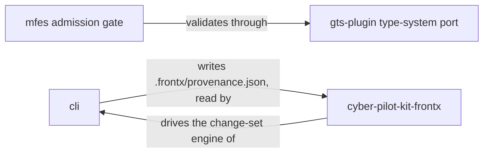

# FrontX Competitive Analysis

**Executive summary.** FrontX is an AI-first front-end platform kit. It is delivered as an ecosystem in three layers:

- published libraries (runtime, type system, API, routing and others)
- templates (externally hosted generators of project content)
- projects orchestration: the command-line interface (CLI), plus the AI Tooling Framework (`@gears-frontx/cyber-pilot-kit-frontx`, "the kit"), which gives AI agents fluency in the ecosystem

It is not a framework in the Next.js sense, and not a single standard like the Module Federation specification. No single incumbent among those assessed was found to span all three layers (see the caveat in section 1). The competitor set is therefore drawn per comparison area. In this document, a *moat* means a durable advantage and a *tax* means an adoption cost.

- **MFE runtime:** FrontX validates each microfrontend (MFE) at registration, at runtime, against a replaceable type-system provider. It admits the MFE into an extension domain, before placement, only if it passes (default-deny). It also governs extension domains through contract matching. This pairing of runtime admission with contract-matched domain governance was not found among the competitors assessed (as of 2026-11-02). OpenMFE offers a manifest validator and a contract-breaking-change check; no runtime admission gate found. Module Federation 2.0 offers dev-time type hints, and no runtime admission gate was found there either. Piral comes closest on governance but has no admission gate. Admission pays off where trust boundaries exist, such as MFEs developed independently by different teams or vendors. It is an adoption cost where they do not, such as single-team apps.
- **AI Tooling Framework:** FrontX ships AI expertise with the scaffolding template. The expertise activates automatically on install when allowed by the project trust policy, a project-owned policy for template AI extensions. That combination was not found among the competitors assessed (as of 2026-11-02). Claude Code project skills, Claude Code plugins and Cursor rules already offer expertise that is shared through the repository and discovered automatically. FrontX is positioned as complementary, not as an alternative: "bring your own agent, we provide the ecosystem fluency".
- **CLI lifecycle:** Three features were not found together among the competitors assessed (as of 2026-11-02): ownership-boundary conflict prevention, per-template provenance, and per-template upgrade change sets. They are a durable advantage for long-lived projects built from several templates, and overhead for one-off scaffolds.
- **Type system:** No equivalent of the replaceable-provider port or the realm-shared type store (a realm is the page's shared JavaScript world) was found among the competitors assessed (as of 2026-11-02). The main adoption cost is format community size: the Global Type System (GTS) has a smaller community than Zod.

**Strategic verdict:** Cross-layer integration plus the AI-extension contract is a moat where trust boundaries and AI-driven lifecycle work exist. Examples are enterprise portals, marketplaces, plugin ecosystems and multi-team products. Where they do not exist, it is a cognitive tax. FrontX wins for composable platforms with trust boundaries; single-layer incumbents win for single-team apps and quick-starts. Competitor-side cells with neither a source link nor a sourced note are this analysis's assessment as of 2026-11-02, not a sourced competitive-intelligence survey; section 4.1 has none (see section 1).

<!-- toc -->

- [1. Purpose and scope](#1-purpose-and-scope)
- [2. FrontX at a glance](#2-frontx-at-a-glance)
- [3. Competitive set](#3-competitive-set)
- [4. Area-by-area comparison](#4-area-by-area-comparison)
  - [4.1 MFE runtime vs. client-side orchestrators](#41-mfe-runtime-vs-client-side-orchestrators)
  - [4.2 AI Tooling Framework vs. agent extension ecosystems](#42-ai-tooling-framework-vs-agent-extension-ecosystems)
  - [4.3 CLI template lifecycle vs. scaffolding and lifecycle tools](#43-cli-template-lifecycle-vs-scaffolding-and-lifecycle-tools)
  - [4.4 Type system vs. runtime admission type systems](#44-type-system-vs-runtime-admission-type-systems)
  - [4.5 Strategic positioning](#45-strategic-positioning)
- [5. Where FrontX wins, where single-layer incumbents win](#5-where-frontx-wins-where-single-layer-incumbents-win)
- [6. References](#6-references)

<!-- /toc -->

## 1. Purpose and scope

This document compares the FrontX ecosystem against competing technologies.
It identifies the competitive set per comparison area. It then compares FrontX
feature by feature against the strongest incumbents in each area. Finally, it
sets out a strategic positioning that states where FrontX wins and where
single-layer incumbents win.

The analysis is grounded in the FrontX architecture artifacts: the root PRD and
DESIGN, the member PRDs, the DESIGNs of the compared members, and the FEATUREs
and ADRs listed in section 6.

**Evidence basis and shelf life.** The FrontX-side cells in every comparison
table are grounded in the FrontX architecture artifacts. Competitor-side cells
that carry a source link, or a note that cites one, were checked against that
source on 2026-11-02. In section 4.1, a cell reading "not found (docs reviewed)"
(for Piral, "secondary docs reviewed") means the docs listed in its note were
reviewed on that date and showed no such capability, and "not assessed" means no source was found either way.
All other competitor-side cells, which appear only in sections 4.2 to 4.4, are
this analysis's assessment as of 2026-11-02. They were not verified against
competitor documentation, so read them as an assessment, not as a sourced
competitive-intelligence survey. A claim that
something was "not found among the competitors assessed" means exactly that: it
was not found in this set, as of that date. The competitive landscape changes,
so such claims should be re-checked periodically against current competitor
sources.

**Scope of the comparison.** The comparison covers five areas where FrontX
claims structural differentiation, mapped onto the three ecosystem layers:

- Two areas compare published-libraries members: the MFE runtime (`mfes`,
  with the routing libraries `routing` and `routing-tanstack`) and the type
  system (`gts-plugin`).
- Two compare projects-orchestration members: the CLI template lifecycle
  (`cli`) and the AI Tooling Framework (`@gears-frontx/cyber-pilot-kit-frontx`).
- The fifth, strategic positioning, spans all three layers.

Routing (`routing`, `routing-tanstack`) is compared in section 4.1 against the
microfrontend orchestrators. The API library (`api`) is not a comparison area:
its row in the section 3 competitive set lists competitors only, and it has no
section 4 table.
Templates are not compared as a layer of their own. They are hosted outside
this repository, and section 4.3 covers how the CLI acquires and applies them.
The published-libraries members `ui-kit` and `telemetry` are out of scope. Both
compete in mature markets (component libraries, observability) where FrontX
does not claim a durable advantage. They are listed in section 2 for
completeness but do not appear in the comparison tables. The root DESIGN also
names two categories outside the layers, build internals and non-package code;
neither is compared here.

FrontX is not a single product; it is a three-layer ecosystem. No single
incumbent among those assessed was found to span all three layers. The
competitor set is therefore drawn per comparison area. The strategic question
is whether FrontX's cross-layer integration plus its AI-extension contract is a
moat or a cognitive tax, compared with composing single-layer best-of-breed
tools.

## 2. FrontX at a glance

FrontX exists to enable AI-driven creation of frontend projects. It gives teams
a product set in which AI agents can reliably scaffold, extend, and evolve
frontend projects. Agents do this by targeting stable, narrow,
explicitly-contracted product capabilities instead of improvising against an
open-ended codebase. Canonical source:
[the root PRD §1.1](../architecture/PRD.md#11-purpose).

The ecosystem is delivered in three layers. The canonical layer definition is
[architecture/DESIGN.md §1.3](../architecture/DESIGN.md#13-architecture-layers),
where layer membership is a property, not a list. The member column below is a
snapshot as of 2026-11-02.

| Layer | Members (snapshot, 2026-11-02) | Role |
|-------|--------------------------------|------|
| Published libraries | `mfes`, `gts-plugin`, `api`, `routing`, `routing-tanstack`, `ui-kit`, `telemetry` | Units consumed as versioned dependencies |
| Templates | Externally hosted, resolved by source-spec | Generators of project content, applied into a receiving repository |
| Projects orchestration | `cli`, `@gears-frontx/cyber-pilot-kit-frontx` | Units that act on a project's lifecycle: create, assemble, upgrade, and give AI agents ecosystem fluency |

Key ecosystem-level properties:

- UI-framework-agnostic (any UI framework works, including React, Vue, Svelte, vanilla JS)
- Versioned platform evolution with compatibility commitments (semver discipline, no lockstep upgrades)
- No architectural ceiling on application complexity (scale is governed by non-functional requirement (NFR) thresholds, not by structure)
- Per-concern independent versioning (each artifact on its own semver line)
- Layer-member governance (every package classified, every member owns its artifact chain)

## 3. Competitive set

FrontX spans three layers, and no single incumbent among those assessed was
found to span all three. The competitor set is therefore drawn per comparison
area. Templates have no row of their own; they are covered through the CLI row,
because the CLI acquires and applies them. The API row lists the competitive
set only. API is not a comparison area and has no section 4 table.

| Comparison area (members) | Deterministic competitors | AI-first / agentic competitors |
|---|---|---|
| MFE runtime (`mfes`, `routing`, `routing-tanstack`) | single-spa, Module Federation, qiankun, Piral, Luigi, OpenMFE | not applicable |
| Type system (`gts-plugin`) | Zod-at-boundary, tRPC procedures, OpenAPI validators, Effect Schema, Valibot | not applicable |
| API (`api`) | axios + React Query, tRPC | not applicable |
| CLI (`cli`) | Nx generators, Yeoman, Plop, Vite create-*, degit + GitHub templates | Bolt.new, v0, T3 CLI |
| AI Tooling Framework (`@gears-frontx/cyber-pilot-kit-frontx`) | Claude Code skills, Model Context Protocol (MCP) servers, Continue config, .cursor/rules | Claude Code, Cursor, Devin, Copilot Workspace |

Scoping decisions:

- The MFE-runtime comparison covers client-side orchestrators only. It has a
  separate callout for Module Federation, which blurs the line between build
  time and runtime. Server-side composition (Podium, Ara Framework) solves a
  different problem that FrontX does not claim.
- The routing competitors are the microfrontend orchestrators, compared in
  section 4.1. A router engine is the library that matches URLs to screens.
  TanStack Router and React Router are treated here as router engines FrontX
  plugs in, not as competitors. FrontX plugs them in through its
  engine-provider port, the plug-in point for a router engine, and
  `@gears-frontx/routing-tanstack` is the default provider.
- The AI-tooling comparison has two axes. The first is general-purpose agent
  fluency, where FrontX's edge is pre-bundled ecosystem knowledge, not the
  agent itself. The second is agent extension ecosystems. There, FrontX's edge
  is template-bundled extensions gated by a project trust policy, versus
  repository-shared skills and approval-gated MCP servers.
- The scaffolding comparison also has two axes. The first is the deterministic
  template and assembly lifecycle, where FrontX's edge is source-spec
  versioning, conflict prevention and reviewable upgrades. The second is
  AI-first scaffolding, where FrontX's edge is contract-governed, repeatable
  output rather than free-form generation.
- The type-system comparison is framed as runtime admission type systems, not
  as a comparison of schema formats. The format is replaceable by design; the
  differentiator is the admission contract plus the realm-shared store pattern.

## 4. Area-by-area comparison

Each table uses a small set of verdicts: **yes**, **partial**, **no**, **not
found**, and **not assessed**, each followed by a short qualifier. Competitor
cells with neither a source link nor a sourced note are assessment as of
2026-11-02; section 4.1 has none. A FrontX feature marked
"not found elsewhere" was not found among the competitors assessed. Numbered
notes under each table give the detail and the extra sources behind a cell.

### 4.1 MFE runtime vs. client-side orchestrators

`@gears-frontx/mfes` is the ecosystem's runtime substrate. It registers
MFEs with a running application and loads them on demand. It places
them into governed extension domains and mediates their communication with the
host. It validates each unit against type definitions at registration and
admits it before placement into a domain. Canonical source:
[mfes DESIGN](../packages/mfes/architecture/DESIGN.md). The three routing rows
compare how each orchestrator keeps the URL in step with each domain's
occupants, the MFEs mounted in it. Their FrontX side comes from the
`@gears-frontx/routing` package's
[routing DESIGN](../packages/routing/architecture/DESIGN.md).

| Axis | FrontX `mfes` | single-spa | Module Federation | qiankun | Piral | Luigi | OpenMFE |
|---|---|---|---|---|---|---|---|
| Admission-time type validation | yes — at registration, default-deny; not found elsewhere (note 1) | not found (docs reviewed, note 14) | partial — dev-time type hints only; no admission gate ([InfoQ](https://www.infoq.com/news/2026/04/module-federation-2-stable)) (note 2) | not found (docs reviewed, note 14) | not found (secondary docs reviewed, note 14) | not found (docs reviewed, note 14) | partial — manifest validator and breaking-change check; no runtime gate found ([manifest](https://github.com/openmfe/manifest)) (note 3) |
| Extension-domain governance (named slots, admission rules, placement, occupant limits, contract matching) | yes | not found — URL-driven mounting only (docs reviewed, note 14) | not found (docs reviewed, note 14) | not found (docs reviewed, note 14) | partial — named extension slots; no contract matching found (secondary; note 13) | not found (docs reviewed, note 14) | no — no slots, placement or admission rules in the spec (note 12) |
| Isolation | yes — own module graph per unit; not a confidentiality boundary (note 4) | no — no CSS isolation built in; selector prefixing advised ([CSS docs](https://single-spa.js.org/docs/ecosystem-css)) | no — shares the host's module graph and singletons ([MF shared](https://module-federation.io/configure/shared)) | partial — JS sandboxes; closest among the sandbox-based approaches assessed ([doc mirror](https://tomevault.io/tome/umijs/qiankun/sandbox)) (note 10) | not assessed — no source found either way | not assessed — repo shows iframe and Web Component containers, not their isolation guarantees ([repo index](https://docsearch.algolia.com/mcp/docs/repo/luigi-project/luigi)) | partial — Shadow DOM (see note 12) and no globals; required, not enforced |
| UI-framework agnosticism | yes — core library, must stay UI-framework-agnostic | yes — parcels work with React, Angular, Vue or any framework ([parcels](https://single-spa.js.org/docs/parcels-overview)) | partial — bundler-coupled; many bundlers since 2.0 ([Rspack](https://rspack.rs/guide/features/module-federation)) (note 5) | not assessed — no source found either way | partial — pilets via converters; React-based shell ([piral-vue](https://www.npmjs.com/package/piral-vue)) (note 6) | yes — Svelte core, described as technology-agnostic ([SAP](https://developers.sap.com/tutorials/luigi-getting-started.html)) | yes — a custom element (see note 12), buildable with any framework |
| Host-MFE communication | yes — actions-chains mediator plus a narrow parent–child capability bridge | partial — left to teams, such as CustomEvents or utility modules ([iFood, secondary](https://medium.com/ifood-engineering/cross-micro-frontends-communication-dbca37802b60)) | partial — direct calls through the shared module graph ([MF shared](https://module-federation.io/configure/shared)) | yes — global state via `initGlobalState` ([API mirror](https://qiankun-2ne17hw3c.vercel.app/api)) | yes — pilet API events and shared data (secondary; note 13) | yes — postMessage between Luigi Core and Client ([Luigi core](https://github.com/SAP/luigi/blob/main/core)) | yes — attributes, CustomEvents and functions, declared in the manifest (note 12) |
| Multi-occupant domains | yes | not found (docs reviewed, note 14) | not found (docs reviewed, note 14) | not found (docs reviewed, note 14) | yes — a slot renders all components registered under its name (secondary; note 13) | not found (docs reviewed, note 14) | no — no domain concept in the spec (note 12) |
| One shared navigation history per page, unreachable by shell and MFE code | yes — one history per realm, reached only by FrontX; not found elsewhere (note 7) | no — any `history.pushState` call triggers a reroute ([release notes](https://newreleases.io/project/github/single-spa/single-spa/release/v5.7.0)) | no — inferred; no routing in the core (note 11) | no — one shared URL; micro apps navigate with `history.pushState()` ([FAQ](https://qiankun.umijs.org/faq)) (note 10) | no — pilets use one shared shell router directly (secondary; note 13) | partial — Core handles the URL; can suppress history entries ([API](https://raw.githubusercontent.com/luigi-project/luigi/main/docs/luigi-client-api.md)) (note 10) | partial — the spec forbids the MFE to modify the URL ([spec](https://raw.githubusercontent.com/openmfe/specification/main/specification.md)) (note 12) |
| URL and mounted extensions kept in agreement across nested domains and domains with several occupants (cold load, reload, back/forward) | yes — settles to agreement, with listed divergences ([ADR 0036](../architecture/ADR/0036-extension-routing-port.md)); not found elsewhere (note 8) | partial — URL-driven activation; nested or multi-occupant agreement not found ([docs](https://single-spa.js.org/docs/api/)) (note 10) | partial — host route per remote, via the optional bridge ([npm](https://npmjs.com/package/@module-federation/bridge-react)) (note 11) | partial — URL-driven activation; nested or multi-occupant agreement not found ([cookbook](https://qiankun.umijs.org/cookbook)) (note 10) | partial — multi-occupant slots; URL-driven placement into them not found ([secondary doc](https://docs.axinom.com/platform/packages/mosaic-portal)) (note 13) | partial — navigation-node tree; no per-domain occupancy addressing found ([docs](https://raw.githubusercontent.com/luigi-project/luigi/main/docs/navigation-configuration.md)) (note 10) | no — the spec defines no routing; the host owns the URL ([spec](https://raw.githubusercontent.com/openmfe/specification/main/specification.md)) (note 12) |
| Router engine swappable inside one MFE without touching the host or sibling MFEs | yes — engine-provider port, TanStack Router by default; not found elsewhere (note 9) | partial — each app handles its own sub-routes; no engine port found ([docs](https://single-spa.js.org/docs/configuration)) (note 10) | partial — each remote's exposed router handles its internal routes ([Telia blog](https://engineering.telia.no/blog/micro-frontends-with-webpack-module-federation)) (note 11) | partial — each micro app has its own router; one shown at a time ([FAQ](https://qiankun.umijs.org/faq)) (note 10) | not found — no engine port in the secondary sources (note 13) | not assessed — the Luigi Client API does not document this (note 10) | no — the MFE must not react to the URL, so has no router (note 12) |
| Type-system port (replaceable provider) | yes — injectable port; not found elsewhere | not found (docs reviewed, note 14) | not found (docs reviewed, note 14) | not found (docs reviewed, note 14) | not found (secondary docs reviewed, note 14) | not found (docs reviewed, note 14) | no — JSON Schema fixed by the spec (note 12) |
| AI-agent-targetable surface (stable, narrow, explicitly contracted) | yes (design intent per root PRD) | not found (docs reviewed, note 14) | not found (docs reviewed, note 14) | not found (docs reviewed, note 14) | not found (secondary docs reviewed, note 14) | not found (docs reviewed, note 14) | partial — machine-readable manifest and JSON-LD (see note 12) endpoint; no AI-agent mention |
| Stated NFRs | yes — registration ≤ 50 ms p95 per call, ≥ 20 registrations/s, on-demand load ≤ 1500 ms p95, ≥ 100 concurrently registered MFEs (snapshot 2026-11-02; canonical: mfes PRD) | not found (docs reviewed, note 14) | not found (docs reviewed, note 14) | not found (docs reviewed, note 14) | not found (secondary docs reviewed, note 14) | not found (docs reviewed, note 14) | no — none in the spec, only caching headers (note 12) |

Notes:

1. FrontX validates each MFE against a replaceable type-system provider when
   it is registered, at runtime. It admits an extension into a domain only
   after validation and contract matching succeed, before placement
   ([mfes PRD](../packages/mfes/architecture/PRD.md),
   [mfes DESIGN](../packages/mfes/architecture/DESIGN.md)).
2. Module Federation 2.0 generates and loads remote-module types at development
   time ([InfoQ](https://www.infoq.com/news/2026/04/module-federation-2-stable)).
   Its runtime checks shared-module versions
   ([MF shared](https://module-federation.io/configure/shared)).
3. OpenMFE offers a manifest validator, `@openmfe/manifest`, which checks a
   manifest against the specification, and a contract-breaking-change check,
   the separate `openmfe-contract` command
   ([manifest](https://github.com/openmfe/manifest)). No runtime admission
   gate was found.
4. Each loaded unit runs as its own module instance behind a trust kernel: a
   small audited module that is the only place the runtime imports loaded
   code. The trust kernel imports only `blob:` and `data:` URLs. This is an
   interface-level guarantee, not a confidentiality boundary
   ([mfes DESIGN](../packages/mfes/architecture/DESIGN.md)).
5. Since 2.0, Module Federation supports webpack, Rspack, Rollup, Rolldown,
   Rsbuild, Vite and Metro
   ([InfoQ](https://www.infoq.com/news/2026/04/module-federation-2-stable)).
6. Piral has a rendering-agnostic core with converters for Vue and Angular,
   so pilets can be written in those frameworks
   ([piral-ng](https://www.npmjs.com/package/piral-ng)). The app shell itself
   is React-based: piral-core uses React and React Router
   ([piral-react](https://www.npmjs.com/package/piral-react)). As of 2023, a
   fully framework-agnostic app shell was still an open issue
   ([issue #592](https://github.com/smapiot/piral/issues/592)).
7. FrontX exposes exactly one navigation-history instance per realm. The navigation substrate, the core
   that owns the shared history and URL grammar, holds it. Every runtime in
   the realm shares it: the shell's and each independently bundled MFE's.
   Only FrontX itself, the FrontX router and the engine-provider package reach
   it. (The FrontX router is FrontX's own per-runtime router that keeps the URL
   and the mounted extensions in agreement; it is distinct from the router
   engine.) Shell and MFE code MUST NOT reach it
   ([routing PRD](../packages/routing/architecture/PRD.md),
   [navigation-substrate FEATURE](../packages/routing/architecture/features/navigation-substrate/FEATURE.md)).
   Each runtime reaches only its own subroute, the part of the URL it owns. It
   does so through the navigation facade, the small API each runtime uses to
   navigate its own subroute
   ([ADR 0036](../architecture/ADR/0036-extension-routing-port.md),
   [engine-provider FEATURE](../packages/routing-tanstack/architecture/features/engine-provider/FEATURE.md)).
   This is an interface-level guarantee, not a confidentiality boundary. Any
   script in the same page can still read the URL and the rendezvous slot, the
   realm-global entry through which copies of the runtime exchange each
   occupant's value. Code that deliberately imports `@gears-frontx/routing` can
   also reach the router's methods
   ([ADR 0036](../architecture/ADR/0036-extension-routing-port.md)).
8. The URL has the form `<shell-subroute>?domain-key=extension;...`, where
   `domain-key` is the domain's declared route. The part after `?` is the
   query string. It holds one entry per occupant, an MFE mounted in a domain
   ([navigation-substrate FEATURE](../packages/routing/architecture/features/navigation-substrate/FEATURE.md)).
   Domains can nest inside other domains, and the URL grammar is the same at
   every depth
   ([routing ADR 0003](../packages/routing/architecture/ADR/0003-domain-occupancy-addressing-granularity.md)).
   A Concurrent domain holds several occupants side by side. An Optional
   domain holds at most one, and an Exclusive domain one at a time, replaced
   pre-emptively
   ([ADR 0009](../architecture/ADR/0009-extension-domain-occupancy.md)).
   A page load, a reload and a back or forward step all resolve the same way
   ([route-ownership-signal FEATURE](../packages/routing/architecture/features/route-ownership-signal/FEATURE.md),
   [routing DESIGN, O6](../packages/routing/architecture/DESIGN.md#23-obligations-on-the-frontx-router)).
   The FrontX router changes what is mounted only when the user changes the
   URL. When the runtime changes what is mounted, the router writes that change
   into the URL. A written push or replace therefore sends no mount requests
   ([routing ADR 0002](../packages/routing/architecture/ADR/0002-mount-trigger-ownership.md)).
   The URL then settles to agreement with what is mounted, with the accepted
   divergences listed under the tradeoffs below
   ([ADR 0036](../architecture/ADR/0036-extension-routing-port.md)).
9. An MFE can replace its engine-provider package with another one that
   satisfies the same port. Nothing outside that MFE's own code moves: not the
   navigation substrate, the URL grammar, the host or a sibling MFE
   ([routing PRD](../packages/routing/architecture/PRD.md)).
   `@gears-frontx/routing-tanstack` is the default provider
   ([routing-tanstack PRD](../packages/routing-tanstack/architecture/PRD.md),
   [engine-provider FEATURE](../packages/routing-tanstack/architecture/features/engine-provider/FEATURE.md)).
10. single-spa acts as a top-level router. It activates each top-level app when
    the app's `activeWhen` matches the URL, and each app handles its own
    sub-routes
    ([single-spa configuration](https://single-spa.js.org/docs/configuration)).
    qiankun calls each app's `activeRule`, a path prefix or a function of the
    location, on every URL change
    ([qiankun tutorial](https://qiankun.umijs.org/guide/tutorial)). Luigi Core
    owns a tree of navigation nodes with `pathSegment` and `viewUrl`
    ([Luigi navigation configuration](https://raw.githubusercontent.com/luigi-project/luigi/main/docs/navigation-configuration.md)).
    A third-party source says the nodes nest through `children`
    ([DeepWiki, third-party](https://deepwiki.com/luigi-project/luigi/3.1-navigation-configuration)).
    For all three, no way to keep the URL in agreement across nested domains or
    several occupants per domain was found in the sources read.
    On the shared-history row, the qiankun FAQ says "the browser has only one
    url location". Each micro app's router works under its own base, and only
    one router-based app may be shown at a time. For navigating between micro
    apps, the FAQ recommends `history.pushState()`
    ([qiankun FAQ](https://qiankun.umijs.org/faq)). The "no" verdict is an
    inference from that recommendation: micro apps that call the history
    themselves are not kept away from it. The FAQ does not state this
    directly. In Luigi, Core
    handles the URL change after `linkManager().navigate()`. The `withoutSync`
    option turns that handling off, and `preventHistoryEntry` suppresses a
    history entry
    ([Luigi Client API](https://raw.githubusercontent.com/luigi-project/luigi/main/docs/luigi-client-api.md)).
    The Luigi Client API does not document whether an MFE can reach the browser
    history directly.
    For the router-engine row, the qiankun FAQ says each micro app keeps its own
    router instance under its base, but no more than one router-based app can
    be shown at a time. The Luigi Client API was checked on 2026-11-02 and does
    not document whether an MFE can use its own router, so that cell stays "not
    assessed".
    For the isolation row, qiankun has three sandbox modes: Snapshot, Legacy
    and Proxy. JS isolation is on by default and style isolation is opt-in.
    Its own documentation says the sandbox is not a security boundary
    ([doc mirror](https://tomevault.io/tome/umijs/qiankun/sandbox)). It is the
    closest among the sandbox-based approaches assessed. The Luigi repo index
    shows iframe and Web Component containers, not their isolation guarantees,
    so that cell is "not assessed"
    ([repo index](https://docsearch.algolia.com/mcp/docs/repo/luigi-project/luigi)).
11. Module Federation provides module sharing, not routing. The three routing
    cells rest on different evidence. The router-engine cell ("partial") rests
    on a third-party source: in common setups the host owns routing and each
    remote's router handles its internal routes
    ([Telia blog](https://engineering.telia.no/blog/micro-frontends-with-webpack-module-federation)).
    The URL-agreement cell ("partial") rests on the optional
    `@module-federation/bridge-react` add-on, not the core: the host renders
    each remote under a host route
    ([npm](https://npmjs.com/package/@module-federation/bridge-react)). The
    shared-history cell ("no") is inferred: no module-federation.io page on
    routing was found.
12. OpenMFE's spec defines no routing. It says the MFE MUST NOT modify the
    host page's URL state (§3.7), MUST NOT listen to or react to the URL
    (§3.10), and gets link targets as attributes the host sets (§3.11)
    ([spec](https://raw.githubusercontent.com/openmfe/specification/main/specification.md)).
    Because the MFE must not react to the URL, it has no router of its own.
    The other OpenMFE cells in this table also come from that spec. It defines
    no slots, placement rules or admission. It implies several instances on a
    page (§1.2, §6.3) but has no domain concept. It requires Shadow DOM, a
    browser feature that encapsulates a component's markup and styles, for
    all markup and styles (§3.4). It forbids global variables (§3.9) and
    overriding host APIs (§3.8). These are obligations on the MFE author, not
    runtime enforcement.
    An MFE is a custom element, an HTML tag the MFE defines itself in
    JavaScript, that "MAY be built using vendor frameworks" (§3.1–3.2). It
    takes attributes in (§4), emits CustomEvents out (§5) and may expose public
    functions (§6). All of these are declared in the manifest with JSON Schema
    (§9.3.10–12). Contracts are JSON Schema written in YAML (§2.4,
    §9.2), with no alternative format defined. The spec aims to "allow tooling
    to be built for microfrontend-based systems without knowing implementation
    details". It has a machine-readable YAML manifest and an optional JSON-LD
    semantic endpoint (§8). JSON-LD is a JSON format for machine-readable
    linked metadata. The spec does not mention AI agents. It states no size,
    load-time or performance requirements, only caching headers (§7.4, §8.5).
13. The Piral cells are secondary-sourced; docs.piral.io was not reached.
    Secondary docs built on Piral's pilet API describe events (`emit`, `on`,
    `off`) delivered to all loaded pilets, a shared key/value store
    (`setData`, `getData`), and extensions registered by name. "If multiple
    pilets register an extension component under the same name, the Extension
    component will (by default) render all of them". No contract matching or
    occupant limits on those slots were found
    ([Axinom Mosaic docs, secondary](https://docs.axinom.com/platform/packages/mosaic-portal)).
    The pilet API registers pages with `registerPage(route, Component, meta)`,
    the same docs say the shell renders the page that matches the current URL,
    and piral-core uses React Router
    ([piral-react](https://www.npmjs.com/package/piral-react)). Piral has
    multi-occupant slots, but URL-driven placement into them was not found. No
    engine port was found in these secondary sources. For the
    shared-history row, the shell owns one shared React Router and pilets
    register pages on it. A pilet can bundle its own router. That creates a
    separate history that is not isolated, and it causes "a different routing
    context than the one from the app shell"
    ([Stack Overflow answer, mirror](https://kiwix.lema.org/stackoverflow.com_en_all_2023-11/questions/65839826/you-should-not-use-link-outside-a-router-in-piral)).
14. Docs reviewed on 2026-11-02 for absence claims. A cell reading "not found
    (docs reviewed, note 14)" means these docs were reviewed and showed no
    such capability. For Piral, only secondary docs were reviewed, so its cells
    read "secondary docs reviewed". Neither is a sourced "no". Reviewed:
    single-spa [API](https://single-spa.js.org/docs/api/),
    [configuration](https://single-spa.js.org/docs/configuration) and
    [module types](https://single-spa.js.org/docs/module-types); qiankun
    [API, mirror](https://qiankun-2ne17hw3c.vercel.app/api),
    [FAQ](https://qiankun.umijs.org/faq) and
    [cookbook](https://qiankun.umijs.org/cookbook); Luigi
    [Client API](https://raw.githubusercontent.com/luigi-project/luigi/main/docs/luigi-client-api.md)
    and
    [navigation configuration](https://raw.githubusercontent.com/luigi-project/luigi/main/docs/navigation-configuration.md);
    Module Federation
    [shared configuration](https://module-federation.io/configure/shared) and
    [bridge-react](https://npmjs.com/package/@module-federation/bridge-react);
    and Piral's secondary docs
    ([Axinom Mosaic](https://docs.axinom.com/platform/packages/mosaic-portal)).
    None documents registration-time contract validation, a replaceable
    type-system port, numeric performance floors, or a surface aimed at AI
    agents.
    single-spa, qiankun and Module Federation document URL- or host-driven
    mounting, not named slots with admission rules. Luigi's Web Components use `<slot>` for compound components
    ([repo index](https://docsearch.algolia.com/mcp/docs/repo/luigi-project/luigi)),
    not governed admission. None of these four documents a slot that holds
    several occupants. For Piral, `PiralCustomExtensionSlotMap` types extension
    parameters at compile time (TypeScript). That is not a runtime admission
    check.

**How FrontX stands:**

- **Registration-time, runtime, default-deny admission against a replaceable
  type-system provider was not found among the competitors assessed (as of
  2026-11-02).** FrontX checks each MFE when it is registered. It refuses an
  invalid one before placement, so nothing is admitted until every check
  passes (default-deny). OpenMFE offers a manifest validator and a
  contract-breaking-change check; no runtime admission gate found. Module
  Federation 2.0 offers dev-time type hints and shared-version checks, and no
  runtime admission gate was found there either. Within the set assessed, this
  is the main runtime differentiator identified.
- **Piral is the closest analogue** on extension-domain governance, with slots,
  pilets and a communication API. No contract-matching admission or runtime
  type validation was found for it (as of 2026-11-02). The Piral evidence is
  secondary (note 13), so on this evidence it does not match FrontX on
  admission.
- **qiankun is the closest among the sandbox-based approaches assessed**, through
  its JS sandboxes, but no governance or admission was found. Its own documentation says its sandbox reduces
  accidental interference and is not a security boundary for untrusted code
  ([qiankun sandbox, doc mirror](https://tomevault.io/tome/umijs/qiankun/sandbox)).
  FrontX states a similar limit for itself: its isolation is an interface-level
  guarantee, not a confidentiality boundary.
- **Module Federation (MF) dominates on adoption** and build-time composition,
  but it shares the module graph, so it gives no isolation. It checks
  shared-dependency versions at runtime and, since 2.0, offers dev-time type
  hints for remote modules. It has no gate that refuses a unit at
  registration. MF is the one client-side competitor that blurs the line
  between build time and runtime. Since 2.0 it also works across many
  bundlers rather than webpack alone.

**The tradeoff:** Admission is a moat where trust boundaries exist. That means
MFEs developed independently by different teams or vendors, as in enterprise
portals, marketplaces and plugin ecosystems. Where one team owns all MFEs,
admission is an adoption cost. Module Federation and single-spa win that
segment, because they are easier to adopt without registration-time contracts.
Routing adds costs that FrontX documents itself:

- Occupancy lives in the query string, the part of the URL after `?`, not in
  the path. Bookmarks and external links built from a path cannot address an
  occupant
  ([ADR 0003](../packages/routing/architecture/ADR/0003-domain-occupancy-addressing-granularity.md),
  [navigation-substrate FEATURE](../packages/routing/architecture/features/navigation-substrate/FEATURE.md)).
- Domain keys must be unique among the routed
  domains live on the page. Two live instances of the same host MFE need two
  separate domains, each with its own key
  ([ADR 0003](../packages/routing/architecture/ADR/0003-domain-occupancy-addressing-granularity.md)).
- An extension's declared route stays stable only through convention and a
  registration-time check, not the type system. Changing it breaks existing
  links
  ([ADR 0004](../packages/routing/architecture/ADR/0004-occupant-identity-stability.md)).
- Shell and MFE code get no direct control of routing or the history. Each
  reaches only its own subroute through the navigation facade
  ([routing PRD](../packages/routing/architecture/PRD.md),
  [navigation-substrate FEATURE](../packages/routing/architecture/features/navigation-substrate/FEATURE.md),
  [ADR 0036](../architecture/ADR/0036-extension-routing-port.md),
  [engine-provider FEATURE](../packages/routing-tanstack/architecture/features/engine-provider/FEATURE.md)).
- The routing privacy is an interface guarantee, not a confidentiality
  boundary. Code in the same page can still reach routing state outside
  FrontX's interfaces, in the ways note 7 lists
  ([ADR 0036](../architecture/ADR/0036-extension-routing-port.md)).
- The URL can briefly disagree with what is mounted. A Concurrent remount can
  briefly show a removed extension, and a correction written during a mount
  briefly shows the previous one. A typed or bookmarked address naming two
  extensions for an Exclusive or Optional domain shows both until the runtime
  first settles. A user can therefore briefly see an address that does not
  match the screen
  ([ADR 0036](../architecture/ADR/0036-extension-routing-port.md)).
- Some failures and corrections leave lasting side effects. A failed
  application push can leave a history entry equal to the previous one, and a
  correction after stepping back or forward to an unknown address makes the
  next Forward step do nothing. A replacement that fails before it evicts
  leaves the host's nested URL entries cleared while its nested occupants stay
  mounted. Back and Forward can therefore include steps that change nothing,
  and the URL can omit nested occupants that are still on screen
  ([ADR 0036](../architecture/ADR/0036-extension-routing-port.md)).

### 4.2 AI Tooling Framework vs. agent extension ecosystems

`@gears-frontx/cyber-pilot-kit-frontx` is the ecosystem's AI Tooling Framework
("the kit"). It equips AI agents with ecosystem-wide capabilities and lets
templates bundle their own AI extensions. In consuming projects, it activates
the extensions the project trust policy allows, with no manual wiring. It also
orchestrates AI-driven template upgrades over the CLI's change-set engine. It
ships no template-specific content; solution expertise arrives only through
template bundles. Canonical source:
[cyber-pilot-kit-frontx DESIGN](../packages/cyber-pilot-kit-frontx/architecture/DESIGN.md).

| Axis | FrontX AI Tooling Framework | Claude Code skills | MCP servers | Continue config | .cursor/rules | General-purpose agents (Claude Code, Cursor, Devin, Copilot Workspace) |
|---|---|---|---|---|---|---|
| Template-bundled AI extensions (expertise travels with the template) | yes — template ships skills, workflows, guidelines, reference artifacts; not found elsewhere | partial — project skills shared through git; plugins bundle skills ([skills](https://code.claude.com/docs/en/skills)) (note 1) | partial — project servers committed in `.mcp.json`; plugins bundle MCP servers; no bundled expertise or workflows ([MCP](https://code.claude.com/docs/en/mcp)) (note 1) | no — repo-scoped | no — repo-scoped | no |
| Auto-discovery and auto-activation (zero manual wiring) | yes — discovered on install, activated when the project trust policy allows | partial — auto-discovered; a person or a plugin supplies the skills ([skills](https://code.claude.com/docs/en/skills)) | partial — discovered from the repository, each server needs user approval ([MCP](https://code.claude.com/docs/en/mcp)) | no — user writes config | partial — auto-attached; user writes the rules ([Cursor rules](https://docs.cursor.com/context/rules)) | no |
| Project trust policy for extensions | yes — owned by the Project Developer; denied or untrusted capabilities do not activate | partial — workspace trust ([skills](https://code.claude.com/docs/en/skills)) | partial — workspace trust and per-server approval in Claude Code ([MCP](https://code.claude.com/docs/en/mcp)) | no | no | no |
| Ecosystem knowledge at session start | yes — declared rule resources loaded at session start, no training step | partial — via AGENTS.md/CLAUDE.md, manual | no | partial — via config, manual | partial — via rules, manual | no |
| Agent-host-agnostic declaration | yes — kit-installation contract; any conforming host discovers and invokes | no — Claude-specific | partial — protocol is cross-host, config is per host | no — Continue-specific | no — Cursor-specific; Cursor also reads AGENTS.md ([Cursor rules](https://docs.cursor.com/context/rules)) | partial — AGENTS.md is a cross-host instruction file ([AGENTS.md](https://codex.danielvaughan.com/2026/04/07/agents-md-open-standard-cross-tool-portability)) (note 2) |
| AI-driven upgrade orchestration (reviewable change sets, impact analysis) | yes — drives the CLI's change-set engine, adds review gates | no | no | no | no | partial — ad hoc, no contracted engine |
| Solution-agnostic base (no template-specific content in the kit) | yes (CI-enforceable invariant, KIT-2: the packaged base kit contains no template- or solution-named resource) | partial | partial | partial | partial | yes |

Notes:

1. A Claude Code plugin bundles slash commands, subagents, hooks, MCP servers
   and skills as one unit, installed from git-hosted marketplaces
   ([plugins, third-party](https://www.morphllm.com/claude-code-marketplace)).
   Plugins install from a marketplace, not with the template that scaffolded
   the project.
2. AGENTS.md is read by Codex, Cursor, Copilot, Devin and others
   ([AGENTS.md](https://codex.danielvaughan.com/2026/04/07/agents-md-open-standard-cross-tool-portability)).

**How FrontX stands:**

- **Expertise that travels with the scaffolding template, activated under the
  project trust policy, was not found among the competitors assessed.** The
  nearest analogues are close. Claude Code discovers project skills from the
  repository and shares them through git. Claude Code plugins bundle skills
  and MCP servers for install from marketplaces, and Cursor rules attach
  automatically. Project MCP servers committed in `.mcp.json` are also shared
  through the repository, but each needs user approval. None of them carries
  the expertise with the template that scaffolded the project, gated by a
  project trust policy.
- **The project trust policy is owned by the Project Developer.** The Project
  Developer decides which template AI extensions activate; denied or untrusted
  capabilities do not activate. Claude Code has a related mechanism: a
  workspace trust dialog, plus approval of each project MCP server, so a
  cloned repository cannot approve its own servers
  ([MCP](https://code.claude.com/docs/en/mcp)). FrontX differs in scope. One
  project-owned policy governs every template AI extension, rather than trust
  per workspace or per server.
- **The agent-host-agnostic declaration** (kit-installation contract) goes
  beyond host-specific configs. AGENTS.md already gives a cross-host baseline
  for plain instructions, read by Codex, Cursor, Copilot and others
  ([AGENTS.md](https://codex.danielvaughan.com/2026/04/07/agents-md-open-standard-cross-tool-portability)).
  The kit-installation contract adds declared skills and rules that any
  conforming host discovers and invokes. That is a strength, because no
  per-host configuration is needed. It is also a real adoption constraint: the
  contract delivers nothing without a conforming host, so host adoption
  carries the value.

**The positioning:** The kit is a depth play, deep within FrontX projects. It
is not a breadth play that works in any repository, like Cursor or Devin. It is
positioned as complementary, not alternative: the kit is agent fuel, not an
agent. A team using Cursor or Devin inside a FrontX project gets both the
agent's general fluency and the kit's ecosystem and template fluency. This
holds only if the host honors the kit-installation contract.

**The tradeoff:** The template-bundled extension contract is a durable
advantage for template ecosystems with solution-specific expertise. Examples
are a Next.js template bundling Next.js-specific skills, or a design-system
template bundling component-usage guidelines. It depends on bundle quality:
low-quality bundles dilute the ecosystem, which the project trust policy
mitigates.

### 4.3 CLI template lifecycle vs. scaffolding and lifecycle tools

`@gears-frontx/cli` is the ecosystem's projects-orchestration unit for the
repository lifecycle. It installs, lists, updates the local inventory of, and
validates templates from the source registry. It applies a template to seed a
new repository or extend an existing one. It assembles a repository from
several independently applied templates, and it detects and prevents
conflicting assembly. It records per-applied-template provenance and upgrades
each applied template independently as reviewable change sets. Canonical
source: [cli DESIGN](../packages/cli/architecture/DESIGN.md).

T3 CLI is listed in section 3 but not compared in the table below. In this
analysis's assessment it is a single-stack starter generator, while the axes
below target template lifecycle tooling.

| Axis | FrontX CLI | Nx generators | Yeoman | Plop | Vite create-* | degit + GitHub templates | Bolt.new / v0 |
|---|---|---|---|---|---|---|---|
| Versioned source-spec acquisition | yes — deterministic, version-pinned (`host:owner/repo[//subtree]@ref`) | partial — npm packages | partial — npm packages | no | partial — npm create | partial — git ref | no — prompt-based |
| Per-template provenance | yes — one record per applied template; not found elsewhere | no | no | no | no | no | no |
| Ownership-boundary conflict prevention | yes — pre-flight intersection check plus post-materialization guard; not found elsewhere | no | no | no | no | no | no |
| Multi-template assembly (preset resolves referenced templates transitively) | yes | partial — presets | no | no | no | no | no |
| Reviewable, non-destructive upgrade change sets | yes — per template, approvable, reversible | partial — migration generators, reviewed in Nx Console ([Nx Console](https://nx.dev/docs/guides/nx-console/console-migrate-ui)) (note 1) | no | no | no | no | no |
| Pre-publish validation (structure plus ownership boundaries) | yes | partial — schema validation | no | no | no | no | no |
| AI-driven scaffolding from stated intent | yes — via the AI Tooling Framework | partial — Nx MCP server and agentic migrations ([Nx MCP](https://nx.dev/docs/reference/nx-mcp)) (note 2) | no | no | no | no | yes — free-form, not contract-governed |
| Bundles no template content | yes — resolved at runtime | no — generators ship in the repo | no | no | no | no | no |

Notes:

1. Nx Console runs migrations in order and asks the user to review and approve
   each migration's file changes
   ([Nx Console](https://nx.dev/docs/guides/nx-console/console-migrate-ui)).
2. Nx migrations can be deterministic, prompt-only (agentic) or hybrid
   ([migration generators](https://nx.dev/recipes/advanced-plugins/migration-generators)).

**How FrontX stands:**

- FrontX's CLI is a **lifecycle tool**, not just a scaffolding tool. The
  deterministic template, assembly and upgrade lifecycle is the foundation.
  AI scaffolding from intent sits on top of it.
- **Ownership-boundary conflict prevention and per-template provenance were
  not found among the competitors assessed.** No assessed competitor refuses
  conflicting assembly before writing or records provenance per applied
  template.
- **Reviewable upgrade change sets** suit long-lived projects built from
  several templates. Such projects need to stay current across template
  versions without unreviewed changes. For one-off scaffolds that will not
  upgrade, they are overhead. Nx migrations are the closest competitor: Nx
  Console runs them in order and asks the user to review and approve each
  migration's changes
  ([Nx Console](https://nx.dev/docs/guides/nx-console/console-migrate-ui)). The
  difference is scope. FrontX scopes each upgrade to one applied template,
  using that template's provenance record and declared ownership boundary. It
  also refuses conflicting assembly with a pre-flight check.
- **Source-spec versioning** (`host:owner/repo[//subtree]@ref`, where the
  `//subtree` segment is optional) is a meaningful differentiator. It gives
  determinism, because every reference is version-pinned. It also lets one
  repository publish several addressable templates through the subtree
  segment, which npm packages cannot. The tradeoff is that it needs the source
  registry (GitHub) at install time, while npm packages work offline after
  install.

**The tradeoff:** FrontX's CLI is more contracted and more deterministic than
its competitors. That makes it safer for composing several templates but
heavier for single-template quick-starts. degit plus a GitHub template is
faster for a one-off repository. FrontX's value appears when a repository
composes several templates and needs upgrade governance. The AI-first
scaffolders (Bolt.new, v0) win on speed from a prompt, but their output is
free-form and not repeatable. FrontX's edge is contract-governed, repeatable
scaffolding.

### 4.4 Type system vs. runtime admission type systems

`@gears-frontx/gts-plugin` is the ecosystem's default type-system provider. It
supplies the GTS type-definition specification and validates entities against
type definitions. It resolves type-of relationships and registers
application-defined definitions at runtime. It also provides the default
infrastructure type definitions that the runtime lifecycle needs. A conforming
alternative provider can replace it. Canonical source:
[gts-plugin DESIGN](../packages/gts-plugin/architecture/DESIGN.md); the
500-definition threshold is owned by the
[gts-plugin PRD](../packages/gts-plugin/architecture/PRD.md#application-defined-type-definitions-with-runtime-registration).

| Axis | FrontX `gts-plugin` | Zod-at-boundary | tRPC procedures | OpenAPI validators | Effect Schema / Valibot |
|---|---|---|---|---|---|
| Runtime admission validation (MFE validated before it runs) | yes — the runtime's admission gate calls the provider | partial — manual, at component boundary | partial — at procedure call | partial — at request | partial — manual |
| Replaceable default provider (swap format without runtime changes) | yes — injectable port; not found elsewhere | no — Zod is the format | no — tRPC is the format | no — OpenAPI is the format | no |
| Realm-shared type store (one registration known to all compatible copies) | yes — compatible non-isolated copies share one store per realm; not found elsewhere (note 1) | no | no | no | no |
| Type-of relationship resolution (for handler matching) | yes | no | no | no | no |
| Application-defined runtime type registration | yes — at least 500 definitions ([gts-plugin PRD](../packages/gts-plugin/architecture/PRD.md#application-defined-type-definitions-with-runtime-registration)) | partial — compile-time | partial — compile-time | partial — codegen | partial — compile-time |
| Default infrastructure type definitions (working baseline out of the box) | yes | no | no | no | no |

Notes:

1. Non-isolated copies share one store only when their store format, GTS
   library line and built-in set all match. An instance built with
   `isolated: true` keeps a private store
   ([gts-plugin DESIGN](../packages/gts-plugin/architecture/DESIGN.md)).

**How FrontX stands:**

- The comparison is framed as **runtime admission type systems**, not schema
  formats. The format is replaceable by design. The differentiator is the
  admission contract plus the realm-shared store pattern.
- **The replaceable-provider pattern** is a real architectural differentiator.
  The port keeps the runtime format-agnostic, even if few teams write a second
  provider. Replaceability is an architectural guarantee, not a popularity
  contest. Still, the small GTS community compared with Zod is a real
  adoption cost.
- **The realm-shared type store** (not found elsewhere) helps composed
  applications whose independently loaded MFEs share type knowledge. Without
  sharing, each runtime re-registers every type, and type knowledge across
  MFEs stays invisible. For single-MFE applications that do not share types
  across MFEs, the store is extra complexity.
- **First-definition-wins plus conflict reporting** is a safety feature that
  depends on versioning discipline. It prevents silent replacement, a real
  corruption risk in composed applications. It reports conflicts with both
  definitions and the copies involved. The guidance that a type identifier
  names its version mitigates the risk of surprise. Teams that do not version
  identifiers will hit conflicts, which is the system working as designed.

**The tradeoff:** The replaceable-provider pattern is architecturally cleaner,
but its ecosystem is smaller. Zod and tRPC have massive adoption and tooling,
and a FrontX project adopting gts-plugin buys into a smaller format community.
The durable advantage is the admission plus shared-store pattern; the adoption
cost is format community size.

### 4.5 Strategic positioning

FrontX is positioned as an **AI-first front-end platform kit**: a bundle of
contracts, scaffolding and AI agent fluency for a specific domain. It is not a
framework in the Next.js sense, and it is not a single standard like the
Module Federation specification. No single incumbent among those assessed was
found to span all three FrontX layers (see the caveat in section 1).

**The core strategic question: moat or cognitive tax?**

The moat case: The three layers are designed to integrate.

- The runtime's admission gate calls the type-system port
  ([mfes DESIGN §1.2](../packages/mfes/architecture/DESIGN.md#12-architecture-drivers);
  `cpt-frontx-adr-runtime-type-system-coupling`).
- The CLI writes per-template provenance records in `.frontx/provenance.json`
  ([cli DESIGN, CLI-7](../packages/cli/architecture/DESIGN.md#cli-7--per-applied-template-provenance)),
  and the AI Tooling Framework reads them
  ([cyber-pilot-kit-frontx DESIGN §2.1](../packages/cyber-pilot-kit-frontx/architecture/DESIGN.md#integration-through-public-surfaces-and-filesystem-handoffs-only);
  `cpt-frontx-adr-project-provenance-record`).
- The AI Tooling Framework orchestrates the CLI's change-set engine
  ([cyber-pilot-kit-frontx DESIGN, KIT-3](../packages/cyber-pilot-kit-frontx/architecture/DESIGN.md#kit-3--orchestrates-does-not-reimplement-the-clis-engines);
  `cpt-frontx-adr-ai-driven-upgrade-orchestration`).

A team composing single-layer tools, such as single-spa plus Zod plus Nx plus
Claude Code, gets none of this integration. Its MFE runtime does not validate
types at admission, and its scaffolder records no provenance for the AI agent
to read. Its AI agent cannot orchestrate reviewable upgrades either. The
integration is the durable advantage.

The cognitive-tax case: The three layers impose a cognitive load that a team
would not have with single-layer tools. The kit-installation contract
(`cpt-frontx-contract-kit-installation`), the source-spec
(`cpt-frontx-adr-source-spec-syntax`) and the type-system port are disciplines
a team using degit, Vite and Cursor never meets. That cost is real for teams
that do not need cross-layer integration.

**Where FrontX wins:** Teams building composable front-end platforms with trust
boundaries, where AI agents scaffold, extend and upgrade. Examples are
enterprise portals, marketplaces, plugin ecosystems and multi-team products.
This matches the stated intent of
[the root PRD](../architecture/PRD.md#11-purpose): AI-driven creation of
frontend projects, with stable, narrow, explicitly-contracted product
capabilities.

**Where single-layer incumbents win:** Single-team applications, quick-start
projects, and teams that do not need admission contracts or upgrade governance.

## 5. Where FrontX wins, where single-layer incumbents win

**FrontX wins** when a team needs:

- Composable front-end platforms with trust boundaries across teams or vendors
- AI agents that scaffold, extend, and upgrade reliably against stable contracts
- Multi-template repositories with upgrade governance and conflict prevention
- Registration-time, runtime, default-deny admission of independently developed MFEs against a replaceable type-system provider
- Template-bundled AI expertise that activates automatically on install, when allowed by the project trust policy

**Single-layer incumbents win** when a team needs:

- A single-team application with no trust boundaries across MFEs
- A quick-start one-off repository (degit plus a GitHub template is faster)
- Maximum format-community size and tooling (Zod, tRPC)
- A general-purpose agent that works in any repository without a kit
- No lifecycle governance or upgrade change-set discipline

The "not found" claims behind these lists hold for the competitors assessed,
as of 2026-11-02 (see section 1).

In short, FrontX's cross-layer integration plus the AI-extension contract pays
off where trust boundaries and AI-driven lifecycle work exist, and costs more
than it returns where they do not. The product's value is measured by how
predictably and safely AI agents and their human collaborators can produce and
maintain real frontend applications on top of it.

## 6. References

The FrontX architecture artifacts below govern every FrontX-side cell and
prevail over this document where the two differ; this analysis's assessment
governs only the competitor-side cells.

**FrontX architecture artifacts, by comparison area**

- Ecosystem and strategic positioning (sections 2, 4.5):
  - [FrontX root PRD](../architecture/PRD.md)
  - [FrontX root DESIGN](../architecture/DESIGN.md)
- MFE runtime (section 4.1):
  - [MFE runtime PRD](../packages/mfes/architecture/PRD.md)
  - [MFE runtime DESIGN](../packages/mfes/architecture/DESIGN.md)
- AI Tooling Framework (section 4.2):
  - [AI Tooling Framework PRD](../packages/cyber-pilot-kit-frontx/architecture/PRD.md)
  - [AI Tooling Framework DESIGN](../packages/cyber-pilot-kit-frontx/architecture/DESIGN.md)
- CLI template lifecycle (section 4.3):
  - [FrontX CLI PRD](../packages/cli/architecture/PRD.md)
  - [FrontX CLI DESIGN](../packages/cli/architecture/DESIGN.md)
  - [Template resolution FEATURE](../packages/cli/architecture/features/template-resolution/FEATURE.md)
- Type system (section 4.4):
  - [GTS type-system provider PRD](../packages/gts-plugin/architecture/PRD.md)
  - [GTS type-system provider DESIGN](../packages/gts-plugin/architecture/DESIGN.md)
- MFE runtime, routing members (section 4.1):
  - [Routing PRD](../packages/routing/architecture/PRD.md)
  - [Routing DESIGN](../packages/routing/architecture/DESIGN.md)
  - [Navigation substrate FEATURE](../packages/routing/architecture/features/navigation-substrate/FEATURE.md)
  - [Route ownership signal FEATURE](../packages/routing/architecture/features/route-ownership-signal/FEATURE.md)
  - [Routing TanStack provider PRD](../packages/routing-tanstack/architecture/PRD.md)
  - [Routing TanStack provider DESIGN](../packages/routing-tanstack/architecture/DESIGN.md)
  - [Engine provider FEATURE](../packages/routing-tanstack/architecture/features/engine-provider/FEATURE.md)
  - Routing ADRs:
    [0001](../packages/routing/architecture/ADR/0001-occupant-reference-boundary.md),
    [0002](../packages/routing/architecture/ADR/0002-mount-trigger-ownership.md),
    [0003](../packages/routing/architecture/ADR/0003-domain-occupancy-addressing-granularity.md),
    [0004](../packages/routing/architecture/ADR/0004-occupant-identity-stability.md)
  - Root ADRs:
    [0009 extension-domain occupancy](../architecture/ADR/0009-extension-domain-occupancy.md),
    [0036 extension routing port](../architecture/ADR/0036-extension-routing-port.md)
- API (section 3 competitive set only):
  - [API protocol surface PRD](../packages/api/architecture/PRD.md)
  - [API protocol surface DESIGN](../packages/api/architecture/DESIGN.md)
- Out of scope (listed in section 2 only):
  - [UI Kit PRD](../packages/ui-kit/architecture/PRD.md)
  - [Telemetry SDK PRD](../packages/telemetry/architecture/PRD.md)

**Competitor sources (gathered 2026-11-02)**

- Module Federation 2.0 bundler support and dev-time type hints: [InfoQ](https://www.infoq.com/news/2026/04/module-federation-2-stable), [Rspack docs](https://rspack.rs/guide/features/module-federation)
- Module Federation shared-dependency version checks and the shared module graph: [module-federation.io](https://module-federation.io/configure/shared)
- Piral converters and the open framework-agnostic-shell issue (2023): [piral-vue](https://www.npmjs.com/package/piral-vue), [piral-ng](https://www.npmjs.com/package/piral-ng), [issue #592](https://github.com/smapiot/piral/issues/592)
- Piral pilet events, shared data and extension slots (secondary, medium confidence): [Axinom Mosaic docs](https://docs.axinom.com/platform/packages/mosaic-portal)
- Luigi technology-agnostic core and postMessage communication: [SAP tutorial](https://developers.sap.com/tutorials/luigi-getting-started.html), [Luigi core](https://github.com/SAP/luigi/blob/main/core)
- Luigi iframe and Web Component containers (repository index, medium confidence): [docsearch repo index](https://docsearch.algolia.com/mcp/docs/repo/luigi-project/luigi)
- qiankun sandboxes and their limits (doc mirror, medium confidence): [tomevault.io](https://tomevault.io/tome/umijs/qiankun/sandbox)
- qiankun global state via `initGlobalState` (API page mirror, medium-high confidence): [API mirror](https://qiankun-2ne17hw3c.vercel.app/api)
- single-spa routing and `activeWhen`: [API docs](https://single-spa.js.org/docs/api/), [configuration](https://single-spa.js.org/docs/configuration), [5.7.0 release notes](https://newreleases.io/project/github/single-spa/single-spa/release/v5.7.0)
- single-spa framework-agnostic parcels, utility modules and CSS guidance: [parcels](https://single-spa.js.org/docs/parcels-overview), [module types](https://single-spa.js.org/docs/module-types), [CSS](https://single-spa.js.org/docs/ecosystem-css)
- single-spa cross-app communication patterns (secondary, medium confidence): [iFood engineering](https://medium.com/ifood-engineering/cross-micro-frontends-communication-dbca37802b60)
- qiankun `activeRule`: [cookbook](https://qiankun.umijs.org/cookbook), [tutorial](https://qiankun.umijs.org/guide/tutorial)
- qiankun shared URL and router base (official): [FAQ](https://qiankun.umijs.org/faq)
- Luigi Core URL handling after `linkManager().navigate()` (official): [Luigi Client API](https://raw.githubusercontent.com/luigi-project/luigi/main/docs/luigi-client-api.md)
- Luigi navigation nodes (`pathSegment`, `viewUrl`, `children`): [navigation configuration](https://raw.githubusercontent.com/luigi-project/luigi/main/docs/navigation-configuration.md), [DeepWiki, third-party](https://deepwiki.com/luigi-project/luigi/3.1-navigation-configuration)
- Piral `registerPage` (secondary, medium confidence): [Axinom Mosaic docs](https://docs.axinom.com/platform/packages/mosaic-portal), [piral-react](https://www.npmjs.com/package/piral-react)
- Piral pilet-bundled router and separate history (secondary, medium confidence): [Stack Overflow answer, mirror](https://kiwix.lema.org/stackoverflow.com_en_all_2023-11/questions/65839826/you-should-not-use-link-outside-a-router-in-piral)
- Module Federation routing: [bridge-react](https://npmjs.com/package/@module-federation/bridge-react), [Telia engineering blog, third-party](https://engineering.telia.no/blog/micro-frontends-with-webpack-module-federation)
- OpenMFE host-owned URL rules, isolation, communication, schema format and tooling surface: [specification text](https://raw.githubusercontent.com/openmfe/specification/main/specification.md)
- OpenMFE manifest and contract validation: [specification](https://github.com/openmfe/specification), [manifest](https://github.com/openmfe/manifest)
- Claude Code project skills and workspace trust: [code.claude.com skills](https://code.claude.com/docs/en/skills)
- Claude Code plugins, including bundled skills and MCP servers (third-party, medium confidence): [morphllm.com](https://www.morphllm.com/claude-code-marketplace)
- Claude Code project MCP servers in `.mcp.json` and their approval: [code.claude.com MCP](https://code.claude.com/docs/en/mcp)
- Cursor rules and AGENTS.md support: [docs.cursor.com](https://docs.cursor.com/context/rules)
- AGENTS.md as a cross-tool instruction file (secondary, medium confidence): [codex.danielvaughan.com](https://codex.danielvaughan.com/2026/04/07/agents-md-open-standard-cross-tool-portability)
- Nx migrations review, agentic migrations and MCP server: [Nx Console Migrate UI](https://nx.dev/docs/guides/nx-console/console-migrate-ui), [migration generators](https://nx.dev/recipes/advanced-plugins/migration-generators), [Nx MCP](https://nx.dev/docs/reference/nx-mcp)
