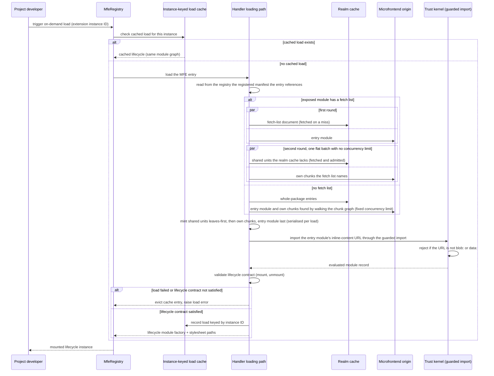
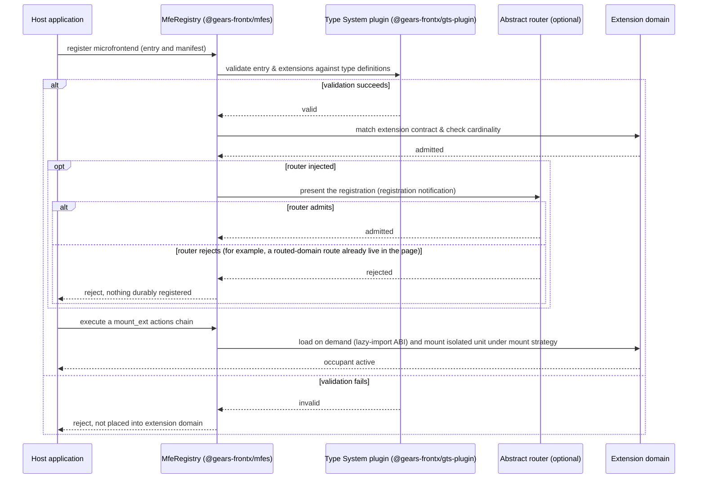
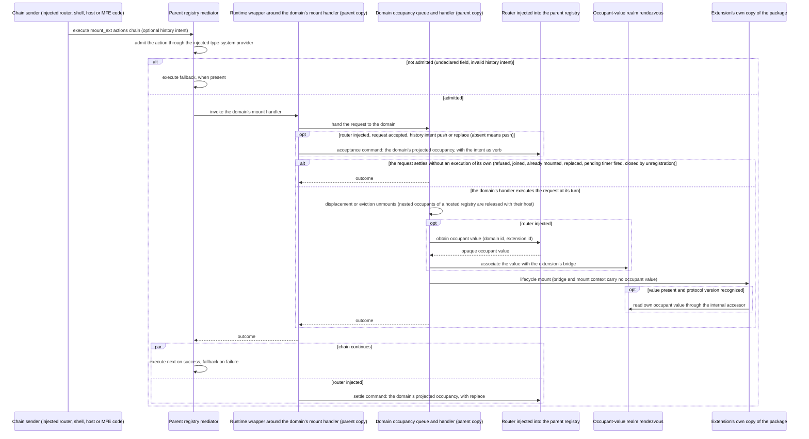
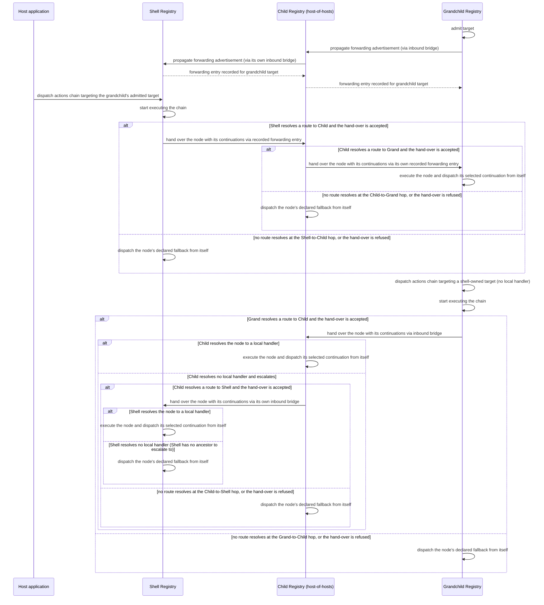

# Technical Design — MFE Runtime

- [ ] `p3` - **ID**: `cpt-frontx-mfes-design-mfe-runtime`

<!-- toc -->

- [1. Architecture Overview](#1-architecture-overview)
  - [1.1 Architectural Vision](#11-architectural-vision)
  - [1.2 Architecture Drivers](#12-architecture-drivers)
  - [1.3 Architecture Layers](#13-architecture-layers)
- [2. Principles & Constraints](#2-principles--constraints)
  - [2.1 Design Principles](#21-design-principles)
  - [2.2 Constraints](#22-constraints)
- [3. Technical Architecture](#3-technical-architecture)
  - [3.1 Domain Model](#31-domain-model)
  - [3.2 Component Model](#32-component-model)
  - [3.3 API Contracts](#33-api-contracts)
  - [3.4 Internal Dependencies](#34-internal-dependencies)
  - [3.5 External Dependencies](#35-external-dependencies)
  - [3.6 Interactions & Sequences](#36-interactions--sequences)
  - [3.7 Database schemas & tables](#37-database-schemas--tables)
- [4. Additional context](#4-additional-context)
- [5. Traceability](#5-traceability)

<!-- /toc -->

## 1. Architecture Overview

### 1.1 Architectural Vision

The MFE Runtime is the substrate a FrontX application loads independently developed units against, without knowing anything about what those units mean. It registers microfrontends and their extensions through an abstract registry facade, discovers and loads them on demand from the registered MFE entry and the registered manifest it references, admits them into governed extension domains only after they pass validation, mediates their communication with the host through a narrow capability bridge, and isolates every loaded unit in its own module graph. None of these five responsibilities requires the runtime to understand a type format, a solution's shared-property vocabulary, or a domain's placement semantics — it reasons about all of them as opaque identifiers and delegates meaning to whoever is injected at the boundary.

The one boundary that makes this possible is the type-substrate port. The runtime carries a declared type identifier as a string, asks an injected provider whether an instance validates and whether one type derives from another, and acts on the verdict — never on the schema itself. This is what lets `@gears-frontx/gts-plugin` be the default provider today and any conforming provider replace it tomorrow without a runtime change, and it is why the runtime's own package holds no dependency on a concrete type-definition specification.

Everything downstream of that boundary follows the same discipline. Extension-domain governance admits an occupant by subset-rule contract matching and a cardinality matrix, never by a domain name the runtime recognizes. The actions-chains mediator routes a chain to a handler keyed by target and action type, never by a shared-property vocabulary the runtime defines. On-demand loading reads locating facts from the closed MFE entry and manifest contracts, and isolation confines every dynamic-code primitive isolation requires to one audited trust-kernel file so the arbitrary-code-admission surface stays provably bounded. The runtime is, deliberately, a substrate that knows how to admit, load, mediate, and isolate — and nothing about what it is admitting. Routing follows the same discipline: an optional router injected at the registry factory owns routing identity, the URL grammar and the writing of the URL, while the runtime registers routed declarations with it, hands its opaque per-extension values to the extension's own copy of the package through a private rendezvous, and, because only the runtime knows how each domain treats its requests, decides what each routed domain's URL entries show and commands the router to write exactly that.

### 1.2 Architecture Drivers

#### Functional Drivers

| Requirement | Design Response |
|-------------|------------------|
| `cpt-frontx-fr-mfe-runtime-registration` | `cpt-frontx-component-mfe-runtime` exposes the abstract `MfeRegistry` facade built via `createMfeRegistryFactory()`, owning the register → type-validate → handler-resolve → domain-admit → load-on-demand → mount sequence; on-demand loading reads locating facts exclusively from the registered MFE entry and the registered manifest it references, read from the registry where it was registered, and every loaded microfrontend evaluates as its own isolated module instance behind the audited trust kernel. Where a router is injected, a domain or extension declaration that carries a route is registered with it and admitted by it before the registration becomes durable, so a registration the router rejects leaves nothing partially admitted (`cpt-frontx-constraint-mfes-router-port`). |
| `cpt-frontx-fr-ui-framework-agnostic` | Handler resolution matches an entry's declared base type through the injected type-system provider rather than a UI-framework-specific self-selection predicate, so the registry carries no assumption about which rendering technology a resolved handler wraps. |
| `cpt-frontx-fr-mfe-type-validation` | Extension admission runs subset-rule contract matching against a domain's declared shared properties and supported actions; entry-handler resolution and the domain's `extensionsTypeId` check run `typeSystem.isTypeOf` against the injected provider, while action handlers match only the exact action type — all before an extension is placed into an extension domain, realizing default-deny admission. |
| `cpt-frontx-fr-application-type-definitions` (owned by the [gts-plugin PRD](../../gts-plugin/architecture/PRD.md)) | The runtime exposes the `TypeSystemPlugin` port opaquely; application code registers its own schemas through the same injected provider the runtime calls for its own well-known infrastructure lifecycle actions, so the runtime never owns a schema of its own. |
| `cpt-frontx-fr-mfe-host-communication` | The actions-chains mediator dispatches by a `(targetId, actionTypeId)` keyed registry and recursive success/fallback chain execution; a narrow parent–child capability bridge exposes exactly the participation methods a child needs, each delegating to the registry or mediator without duplicating coordination logic, alongside the identity of the extension and of the extension domain it occupies. One bridge pair exists per registered extension and is handed to every mount of it, so a child's registrations outlive an unmount and the runtime deactivates rather than destroys a bridge between mounts, refusing every hand-over through an inactive one. Where a mounted extension is itself a host of a further registry, dispatch composes transitively across the resulting nesting: reachability propagates and escalates hop by hop through the bridge connecting each pair of adjacent registries (`cpt-frontx-constraint-mfes-cross-nesting-reachability`), with no growth to the public bridge or registry surface. Mounting, restoration and opening included, is requested only through the `mount_ext` action sent as an actions chain; `mount_ext` and `unmount_ext` each carry one optional, strictly typed history intent (`none`, `replace`, or `push`, an absent intent meaning `push`) that the runtime reads only to choose the verb of the URL command it issues when a domain accepts an application request, `none` issuing no such command. From the wrappers it places around each domain's mount and unmount handlers, the runtime commands an injected router to show the domain's projected occupancy when the domain accepts an application request carrying `push` or `replace`, and again, with `replace`, when each request settles (`cpt-frontx-constraint-mfes-router-port`). |
| `cpt-frontx-fr-mfe-extension-domain-governance` | Extension-domain governance admits an occupant by subset-rule contract matching against the domain's declared shared properties and supported actions, and by the cardinality matrix row of the domain's named mount strategy, never by a domain name the runtime recognizes; an extension is denied admission until both succeed. |
| `cpt-frontx-fr-mfe-load-failure-handling` | A failed load surfaces an `MfeLoadError` (§3.3) naming the affected entry; on-demand loading races each load attempt against the handler's per-attempt timeout budget, gives every retry a fresh budget, and does not retry a failure a repeat attempt cannot change. A timed-out attempt releases what it waited on, so a retry recovers; a load that joins a failed in-flight fetch retries once; a failed load admits no text after the failure and issues no further request (`cpt-frontx-adr-shared-dep-cache-reach`); a declared shared name that survives rewriting fails the load; and eviction from the realm cache costs only a refetch (`cpt-frontx-adr-mfe-asset-discovery`, `cpt-frontx-adr-shared-dep-cache-reach`). |
| `cpt-frontx-fr-mfe-multi-occupant-domain` | Extension-domain occupancy is governed by three composable named mount strategies (Concurrent, Optional, Exclusive) validated against a per-strategy cardinality matrix at domain registration (Concurrent and Optional require `mount_ext` and `unmount_ext`; Exclusive requires `mount_ext` and forbids `unmount_ext`), so a domain accepts side-by-side, displacing, or exclusive occupants according to the strategy its declared lifecycle actions satisfy. |

#### NFR Allocation

| NFR ID | NFR Summary | Allocated To | Design Response | Verification Approach |
|--------|-------------|--------------|-----------------|-----------------------|
| `cpt-frontx-nfr-runtime-performance` | Runtime response-time and throughput targets | `cpt-frontx-component-mfe-runtime` | With a fetch list, a load costs at most two rounds, and a lazy target at most two more on first use, as the on-demand load sequence (§3.6) describes (`cpt-frontx-adr-mfe-asset-discovery`, `cpt-frontx-adr-lazy-import-resolution`); shared-dependency code arrives as content-identified, consumer-independent units (`cpt-frontx-adr-shared-dep-reuse`), and identical content is fetched once per realm while retained within the byte budget of the realm cache (`cpt-frontx-constraint-mfes-realm-shared-dep-cache`); registration and admission run in memory over registry maps that grow only with the registrations they hold (§3.7). | Runtime tests asserting that the fetch-list document and the entry module are requested together, that the second-round batch is issued in full before any response arrives, and that a lazy target is fetched only on first use; load-time benchmarks asserting the runtime's share of the PRD's p95 registration and on-demand-load thresholds. |
| `cpt-frontx-nfr-resource-efficiency` | Bounded transfer, evaluation and retained memory of shared code, with observable figures | `cpt-frontx-component-mfe-runtime` | Shared-dependency source text is transferred once per realm while retained within the byte budget: shared text deduplicates through the single realm cache (`cpt-frontx-constraint-mfes-realm-shared-dep-cache`), a load fetches only the shared units its exposed module's fetch list names and the realm cache lacks, and a lazy target adds only what its own fetch list names and the load lacks (`cpt-frontx-adr-mfe-asset-discovery`, `cpt-frontx-adr-lazy-import-resolution`). Evaluation follows the same lists: a load evaluates only the shared units its fetch list names, and a lazy target adds only the units its own list names (`cpt-frontx-adr-shared-dep-reuse`). Retained shared text — fetch-list documents, list items and whole-package entries — stays within an application-configurable byte budget with least-recently-used eviction; a microfrontend's own code is never admitted to the realm cache (`cpt-frontx-adr-shared-dep-cache-reach`). Retained memory grows with the number of distinct extension instances, never with mount cycles (`cpt-frontx-adr-mfe-load-isolation`). On the fetch-list path each load writes one console diagnostic of the shared bytes it fetched and the realm cache's state (`cpt-frontx-adr-shared-dep-cache-reach`). | Runtime tests confirming retained memory grows only with the number of distinct extension instances — not with unmount/remount cycles — and that retained shared text stays within the configured byte budget; assertions that the per-load diagnostic figures match the cache's state. |
| `cpt-frontx-nfr-security` | Default-deny posture; validated admission | `cpt-frontx-component-mfe-runtime` | Every extension is denied admission until subset-rule contract matching and cardinality validation both succeed; every loaded microfrontend evaluates inside its own module graph behind an audited trust-kernel file whose dynamic-import primitive rejects any URL that is not `blob:` or `data:`, confined there by a custom lint rule. A fully opaque `import(expr)` stays native and is the one accepted exception to isolation; the project that uses a library containing one carries that risk (`cpt-frontx-adr-lazy-import-resolution`). The registered MFE entry and the manifest it references are admitted input, and every location that must stay inside its base is validated to stay there before any request. Shared text is keyed by the content identity its producer declares, which is a sharing key, not a grant of trust in code (`cpt-frontx-adr-mfe-asset-discovery`). No interface the runtime hands to extension or host code — the bridge, the registry, the mount context, lifecycle arguments, actions, or shared properties — exposes an occupant value, so one occupant cannot read or address another's entry; occupant values pass only between copies of the package, through a private realm rendezvous, and between the runtime and the injected router (`cpt-frontx-constraint-mfes-router-port`). That is an interface-level guarantee, not a confidentiality boundary against same-realm code that reads the realm's global object or the raw URL. | Admission audit asserting no extension is mounted without passing the full admission sequence, and a CI boundary check confirming dynamic-code primitives appear only in the trust-kernel file; tests asserting that no occupant value is observable on the bridge, the inbound bridge link, the mount context, lifecycle arguments, actions, or shared properties. |

**ADR coverage references:**

- `cpt-frontx-adr-core-package-boundaries`
- `cpt-frontx-adr-mfe-runtime-public-surface`
- `cpt-frontx-adr-runtime-type-system-coupling`
- `cpt-frontx-adr-mfe-handler-resolution`
- `cpt-frontx-adr-action-dispatch-and-chaining`
- `cpt-frontx-adr-child-mfe-host-access`
- `cpt-frontx-adr-extension-domain-occupancy`
- `cpt-frontx-adr-domain-extension-compatibility`
- `cpt-frontx-adr-mfe-load-isolation`
- `cpt-frontx-adr-lazy-import-resolution`
- `cpt-frontx-adr-mfe-asset-discovery`
- `cpt-frontx-adr-shared-dep-reuse`
- `cpt-frontx-adr-shared-dep-cache-reach`
- `cpt-frontx-adr-extension-routing-port`

### 1.3 Architecture Layers

- [ ] `p3` - **ID**: `cpt-frontx-mfes-tech-runtime-stack`

```mermaid
graph TD
    App[Host application] -->|createMfeRegistryFactory().build| Registry[MfeRegistry facade]
    Registry --> Handler[MfeHandler resolution]
    Registry --> Domain[Extension-domain governance]
    Registry --> Loader[Manifest-driven loading through fetch lists]
    Loader --> RealmCache[Realm cache]
    Loader --> Isolation[Trust-kernel isolation]
    Registry --> Mediator[Actions-chains mediator]
    Mediator --> Bridge[Parent-child capability bridge]
    Registry -- "opaque type-substrate port" --> TypeSystem["Injected TypeSystemPlugin"]
    Domain -- "isTypeOf, validateInstance" --> TypeSystem
    Registry -. "optional abstract router" .-> Router["Abstract router (optional; the FrontX router)"]
    Domain -. "URL command from the handler wrappers (projected occupancy; push or replace at acceptance, replace at settle)" .-> Router
    Domain -- "occupant value, keyed by the extension's bridge" --> Rendezvous["Occupant-value realm rendezvous"]
```

| Layer | Responsibility | Technology |
|-------|---------------|------------|
| Public surface | Registry facade and factory, domain types, handler, bridge and mount-strategy contracts, port types (the type-substrate port and the optional abstract router), the manifest type, the error classes thrown to callers and the shadow-DOM mount utilities on the root entry point; the fetch-list format types on `./unit-format`; the shared-unit fetcher and the location-to-URL resolver on `./unit-loader` | TypeScript, a root entry point and two subpaths, with declarations |
| Registration & admission | Handler resolution, subset-rule contract matching, cardinality validation, extension and domain lifecycle state, registration of routed declarations with an injected router and release notifications to it, occupant-value handover between copies of the package, URL commands to an injected router from the wrappers around each domain's mount and unmount handlers | TypeScript over the injected `TypeSystemPlugin` and the optional injected router, version-namespaced realm-global rendezvous |
| Loading & isolation | Manifest-driven discovery through per-exposed-module fetch lists, shared text keyed by its declared content identity, the realm cache, lazy-import ABI resolution, per-load minting of inline-content references, the audited trust kernel | Browser `fetch`, `Blob`, dynamic `import()`; cross-MFE deduplication of shared source text (no shared module instances) |
| Mediation | Actions-chains mediator, parent–child capability bridge | TypeScript, keyed handler registry |

## 2. Principles & Constraints

### 2.1 Design Principles

#### Opaque Substrate, No Owned Vocabulary

- [x] `p2` - **ID**: `cpt-frontx-mfes-principle-opaque-substrate-vocabulary`

The runtime owns no type format, no shared-property vocabulary, and no extension-domain naming of its own. Every identifier that crosses a runtime boundary — a declared type, a shared property, a domain, an action type — is a string the runtime carries and compares, never a value whose meaning the runtime interprets. Where meaning is required, it is obtained by delegation: to the injected `TypeSystemPlugin` for type validation and hierarchy, to the application for shared-property and domain identity, to an injected router for routing identity and the URL, to the handler for what an admitted entry actually renders.

This matters because the alternative — the runtime recognizing even one concrete vocabulary as a convenience — creates a second path with different capabilities than the one plugins and applications get, and ties the runtime's own evolution to that vocabulary's. Keeping the runtime's admission, mediation, and loading paths free of owned vocabulary is what lets a conforming type-system provider, an arbitrary set of application-defined domains, and an arbitrary shared-property channel all compose against the same runtime without a runtime release.

#### Agnostic core substrate

- [ ] `p2` - **ID**: `cpt-frontx-principle-agnostic-core`

The MFE Runtime stays free of UI-framework choice, concrete type-format knowledge, solution vocabulary and routing grammar. Applications and microfrontends supply those choices through narrow runtime contracts; routing reaches the runtime only through the optional abstract router the runtime declares itself (`cpt-frontx-constraint-mfes-router-port`).

#### Opaque type substrate

- [ ] `p2` - **ID**: `cpt-frontx-principle-opaque-type-substrate`

The runtime carries type identifiers opaquely and delegates schema shape, validation and hierarchy resolution to an injected provider. It does not inspect a concrete type-definition format.

#### Default-deny admission

- [x] `p2` - **ID**: `cpt-frontx-principle-default-deny-admission`

A microfrontend gains placement only after type validation and extension-domain contract checks pass. Loaded units receive only the capabilities granted by their admitted domain.

### 2.2 Constraints

#### MFES-1 — No type-format literals in the MFE Runtime

- [ ] `p2` - **ID**: `cpt-frontx-constraint-mfes-no-type-format-literals`

The MFE Runtime (`@gears-frontx/mfes`) contains no type-system-format string literals. Type identifiers are opaque strings to the runtime; any concrete type-format vocabulary belongs to the type-system plugin or to consumers. This keeps the runtime independent of any single type-definition specification.

**ADRs**: [Partition the Core Framework into Boundary-Governed Concerns](../../../architecture/ADR/0002-core-package-boundaries.md)

#### MFES-2 — No solution-specific shared-property identifiers in the MFE Runtime

- [ ] `p2` - **ID**: `cpt-frontx-constraint-mfes-no-solution-shared-properties`

The MFE Runtime defines no solution-specific shared-property identifiers (such as theme or language vocabulary). Shared-property identity is supplied by the application, so the runtime's communication substrate carries no domain assumptions.

**ADRs**: [Partition the Core Framework into Boundary-Governed Concerns](../../../architecture/ADR/0002-core-package-boundaries.md)

#### MFES-3 — No specific extension-domain values in the MFE Runtime

- [x] `p2` - **ID**: `cpt-frontx-constraint-mfes-no-layout-domain-values`

The MFE Runtime defines no specific extension-domain (layout-domain) values. Which domains exist, what they are named, and what may occupy them are defined by the application, keeping placement vocabulary out of the platform.

**ADRs**: [Partition the Core Framework into Boundary-Governed Concerns](../../../architecture/ADR/0002-core-package-boundaries.md)

#### MFES-4 — No concrete type-format dependency in the MFE Runtime

- [ ] `p2` - **ID**: `cpt-frontx-constraint-mfes-no-type-format-dependency`

The MFE Runtime declares no dependency on any concrete type-system-format implementation. The format provider is injected through the type-substrate port, so the runtime can be composed with any conforming type system.

**ADRs**: [Partition the Core Framework into Boundary-Governed Concerns](../../../architecture/ADR/0002-core-package-boundaries.md)

#### MFES-5 — Opaque schema surface in the MFE Runtime

- [ ] `p2` - **ID**: `cpt-frontx-constraint-mfes-opaque-schema-surface`

The runtime's schema surface is opaque, exposing only a stable identifier. Format-specific schema shape and validation live in the type-system plugin, so the runtime reasons about types solely by identity.

**ADRs**: [The Runtime Coupling to the Type System](../../../architecture/ADR/0004-runtime-type-system-coupling.md)

#### MFES-6 — Cross-nesting reachability without public-surface growth

- [ ] `p2` - **ID**: `cpt-frontx-constraint-mfes-cross-nesting-reachability`

When a mounted extension is itself a host of a further `MfeRegistry`, dispatch and reachability across the resulting nesting depth compose entirely through pairwise, adjacent-registry propagation and escalation carried over the bridge connecting each pair — no registry ever holds a reference to a non-adjacent registry. This composition introduces zero growth to the package's public surface: no new capability method is added to `MfeRegistry`, `ChildMfeBridge`, `ParentMfeBridge`, or any other type declared in the §3.3 API Contracts table. The measure this constraint applies is the capability method, as the enumeration above already implies by naming types rather than members: what a nested composition must not do is give a consumer a new operation to invoke, or a new type to import, in order to reach across nesting. A readonly identity property on a type already on that list — a bridge stating which extension and which extension domain it belongs to, in the same opaque identifiers the runtime already routes by — is identity, not capability, and is therefore outside what this constraint counts, while remaining fully governed by `cpt-frontx-interface-mfe-runtime`'s breaking-change policy like every other member of a published contract. Because a nested composition may involve more than one independently loaded copy of this package (`cpt-frontx-adr-mfe-load-isolation`), the coordination this composition needs at a nested registry's first adoption is carried by a realm-global, version-namespaced rendezvous (the mount-context rendezvous) rather than an exported API — an implicit inter-copy protocol distinct from, and not counted against, the public-surface guarantee above, since it adds no importable symbol and holds, for the duration of one synchronous handoff, only the bridge being handed down and the callback each adopting registry hands back up, ordinarily exactly one — nothing remains at the rendezvous once that window closes. The occupant-value rendezvous MFES-9 describes is a separate realm-global slot, not this one: its entries are associated with an extension's bridge and released with that bridge rather than with one handoff window, and it likewise adds no capability method to `MfeRegistry` or to either bridge, no member to either bridge contract, and no exported symbol.

A nested runtime — the extension's loaded unit, with its own copy of this package — builds its registry once, inside the synchronous handoff of that runtime's first mount, and that registry adopts its host link there; a registry built outside every such handoff is a root. Building once is a contract of the nested runtime's own application, which this package does not enforce. The parent keeps, per extension, the relink callbacks of the registry's adopters as private state — not rendezvous state and not an exported symbol — across an unregistration, so the next mount re-offers the new link to the retained registry with no second build and no rendezvous; it is bounded by the set of extensions the parent has registered (`cpt-frontx-algo-mfe-host-communication-registration-propagation`).

**ADRs**: [Host–MFE Action Dispatch and Chaining](../../../architecture/ADR/0007-action-dispatch-and-chaining.md), [Child MFE Access to the Host](../../../architecture/ADR/0008-child-mfe-host-access.md), [Inject an Optional Abstract Router, Exchange Occupant Values Through a Private Rendezvous, and Command the URL](../../../architecture/ADR/0036-extension-routing-port.md)

#### MFES-7 — Realm-shared dependency source-text reuse

- [x] `p2` - **ID**: `cpt-frontx-constraint-mfes-realm-shared-dep-cache`

Compatible independently loaded copies of this package coexisting in one JavaScript realm converge on a single versioned, bounded cache of shared-dependency source text, the realm cache, so that two loads whose declared content identity already establishes them as reusing the same text (`cpt-frontx-adr-shared-dep-reuse`) fetch that text once for the realm rather than once per copy (`cpt-frontx-adr-shared-dep-cache-reach`). What the copies share is inert source text and nothing else: no module record crosses the boundary, and every load continues to construct its own isolated module graph over that text, so the per-instance isolation `cpt-frontx-adr-mfe-load-isolation` guarantees holds unchanged and the load cache holding evaluated graphs stays scoped to one evaluated copy.

The public footprint of the convergence mechanism is the one `cpt-frontx-adr-shared-dep-cache-reach` states. The cache is reached behind an accessor internal to the package, at a realm-global rendezvous of its own, distinct from the mount-context rendezvous MFES-6 describes, which retains nothing after one synchronous handoff window, and from the occupant-value rendezvous MFES-9 describes, which holds only values associated with a live extension bridge; the parent–child bridge carries participation in dispatch, not loading. The rendezvous is namespaced by an explicit protocol version, so a copy meeting a version or shape it does not recognize leaves that state untouched and falls back to a cache local to itself, bounded by the same byte budget, rather than operating on semantics it cannot establish. That rendezvous is trusted same-realm coordination state and authenticates no publisher: a structurally conforming protocol entry is adopted whichever same-realm code published it, and the version and structural checks guard against accidental incompatibility rather than against a same-realm publisher observing or substituting cached source text (`cpt-frontx-adr-shared-dep-cache-reach` records why that is accepted).

The cache holds every shared text: fetch-list documents, list items and whole-package entries that declare a content identity, each held under that identity as fetched, and whole-package entries that declare none, held under their absolute location. A microfrontend's own code — its entry module, its further and lazy chunks, and the own chunks a fetch list names — is never admitted to it; the handler cache holds only that own code, so the realm byte budget bounds all retained shared text. Code outside the package admits text only through the shared-unit fetcher on `./unit-loader`, under the same discipline a load uses. The cache's capacity bounds the realm rather than each handler, and bounds the bytes of source text it retains — an application-configurable byte budget with least-recently-used eviction, set by the first handler that publishes the realm cache — because a bound on entry count says nothing about bytes when entries range from a small chunk to a whole package. Its lifetime is the realm's: a resident fulfilled value stays strongly reachable, no holder count governs it, and no handler, registry or extension teardown clears it. This constraint covers copies of this package only. An injected type-system provider may keep realm-shared state of its own; this package never reads or writes it.

The `./unit-format` and `./unit-loader` subpaths the §3.3 API Contracts table records are contract surface that `cpt-frontx-adr-shared-dep-reuse` owns — the format contract's single definition site and the shared-unit fetcher and location-to-URL resolver built on it — not an outcome of this cache, and are outside what this constraint counts. The default budget, the configuration key that sets the budget and the capacity of the handler cache are specified in `cpt-frontx-feature-mfe-isolation`.

**ADRs**: [How Far Should the Shared-Dependency Source-Text Cache Reach?](../../../architecture/ADR/0035-shared-dep-cache-reach.md), [How Should Microfrontends Reuse Shared-Dependency Code?](../../../architecture/ADR/0034-shared-dep-reuse.md)

#### MFES-8 — Recursive chain execution

- [ ] `p2` - **ID**: `cpt-frontx-constraint-mfes-recursive-chain-execution`

A chain is fully described by its type: the current action, an optional `next` chain, and an optional `fallback` chain. `executeActionsChain(chain)` takes only the chain and returns nothing awaitable. The runtime executes the action. On success it executes `next` recursively, and on failure it executes `fallback` recursively. Where the selected branch is absent, the chain ends. Chain execution records nothing and issues no command, except a console warning when no handler resolves for an action. The warning names the action's target, type and payload. The URL commands the runtime issues about an occupancy request are not issued by chain execution: they come from the wrappers the runtime places around each domain's `mount_ext` and `unmount_ext` handlers, and are the router port's concern (MFES-9).

An action fails when it does not succeed: it is not admitted (the injected type-system provider rejects it, or its target has not declared it), its handler throws or rejects, its per-action timeout expires (the action's declared timeout, otherwise the domain default), no handler exists for its target, or its hand-over across a hop is refused. The runtime does no ahead-of-time processing of a chain — no validation, no pre-parsing, and no cycle check — and it tracks no origin, status, or completion.

Where the action's target lives in another runtime, the current runtime hands the sub-chain — the action with its `next` and `fallback` — to that runtime, which executes it the same way. Nothing comes back.

**ADRs**: [The MFE Runtime's Public Access Surface](../../../architecture/ADR/0003-mfe-runtime-public-surface.md), [Host–MFE Action Dispatch and Chaining](../../../architecture/ADR/0007-action-dispatch-and-chaining.md), [Child MFE Access to the Host](../../../architecture/ADR/0008-child-mfe-host-access.md), [Inject an Optional Abstract Router, Exchange Occupant Values Through a Private Rendezvous, and Command the URL](../../../architecture/ADR/0036-extension-routing-port.md)

#### MFES-9 — Optional abstract router and private occupant-value exchange

- [ ] `p2` - **ID**: `cpt-frontx-constraint-mfes-router-port`

The MFE Runtime declares an optional abstract router of its own, an abstract class it exports and calls, and accepts a router as an optional part of the registry factory's configuration, in the same way it accepts the type system (`cpt-frontx-adr-runtime-type-system-coupling`). A registry built without a router makes no router call and issues no command.

There is no routing dependency in either direction: the package depends on neither `@gears-frontx/routing` nor `@gears-frontx/routing-tanstack`, and neither depends on it, so the runtime holds no routing grammar. The concrete FrontX router lives in `@gears-frontx/routing` and conforms to the abstract router structurally, without extending it.

The occupant value is private: occupant values pass only between copies of the package, through a realm-global rendezvous of its own, and between the runtime and the injected router. No interface the runtime hands to extension or host code exposes an occupant value, and the runtime never interprets one.

The runtime decides what each routed domain's URL entries show and commands the router; the router writes them.

The abstract router's members, the rendezvous, the history intent, the router's admission path and the commands are specified by `cpt-frontx-feature-mfe-host-communication`, `cpt-frontx-feature-mfe-registry` and `cpt-frontx-feature-extension-domain-governance`.

**ADRs**: [Inject an Optional Abstract Router, Exchange Occupant Values Through a Private Rendezvous, and Command the URL](../../../architecture/ADR/0036-extension-routing-port.md), [Partition the Core Framework into Boundary-Governed Concerns](../../../architecture/ADR/0002-core-package-boundaries.md), [Extension-Domain Occupancy](../../../architecture/ADR/0009-extension-domain-occupancy.md), [How Far Should the Shared-Dependency Source-Text Cache Reach?](../../../architecture/ADR/0035-shared-dep-cache-reach.md)

## 3. Technical Architecture

### 3.1 Domain Model

| Entity | Definition | Representation |
|--------|------------|----------------|
| Schema | A type-definition identity the runtime carries opaquely; the runtime holds only its string identifier and never its structural shape. | Opaque `string` identifier on the runtime's public surface; concrete shape lives behind the injected `TypeSystemPlugin`. |
| MfeEntry | A registrable microfrontend's declared identity: its type identifier, the identifier of the registered manifest it references, and (for the module-federation handler) the exposed module, the file that backs it and its stylesheets. An entry always references a registered manifest. | `MfeEntry` / `MfeEntryMF` types. Lifecycle: the mfe-registry FEATURE specifies a formal state machine (UNREGISTERED → REGISTERED → HANDLER_RESOLVED → ADMITTED → MOUNTED / REJECTED, `cpt-frontx-state-mfe-registry-entry-lifecycle`); the runtime honors the unregister transition and tracks `loadState` and `mountState` per extension instance in place of one reified entry state. |
| Extension | A registered occupant carrying an `MfeEntry`, its declared required properties, supported capabilities, and required domain capabilities, evaluated against a target `ExtensionDomain`'s contract. Any route it declares is carried uninterpreted and registered with the injected router at registration. | `Extension` type; instance-keyed so two extensions sharing one entry definition produce distinct isolated loads. |
| ExtensionDomain | A governed placement composed with one named mount strategy (Concurrent, Optional, or Exclusive) and a declared set of lifecycle actions, validated against a cardinality matrix at registration. Any route it declares is carried uninterpreted and registered with the injected router at registration, which owns its validity and its page-wide uniqueness among routed domains. | `ExtensionDomain` type plus `ExtensionDomainImplementation` / `ExtensionDomainImplementationFactory`. |
| Action / ActionsChain | A typed message dispatched to a `(targetId, actionTypeId)` pair, optionally chained with `next` and `fallback` continuations for recursive success/failure routing. Concrete action schemas are closed and the base action schema is open; `mount_ext` and `unmount_ext` each carry one optional history intent (`none`, `replace`, or `push`, absent meaning `push`). | `Action`, `ActionsChain` types, admitted through the injected type-system provider before dispatch. |
| Abstract router | The optional abstract router (`RouterPort`) the runtime declares and accepts through the registry factory's configuration: the private channel through which an injected router admits and releases routed registrations, supplies occupant values at mount, and receives the runtime's URL command — a domain's projected occupancy, with the verb `push` or `replace` — when a domain accepts an application request and when each request settles (MFES-9). | Abstract contract declared by this package; its members belong to the FEATUREs owning registration and mounting; the concrete FrontX router lives in `@gears-frontx/routing` and conforms structurally. |
| Occupant value | An opaque per-extension value the injected router assigns at mount from the domain id and the extension id; the runtime hands it over and never interprets it. | Held at a version-namespaced realm rendezvous, associated with the extension's bridge from before lifecycle mount until that bridge is released; absent from every interface handed to extension or host code. |
| Manifest | A microfrontend's registered package-level description: where its code and shared files are, which shared dependencies it declares, and, per exposed module, which fetch-list document that module uses. The manifest and MFE entry contracts are closed; their fields are fixed by `cpt-frontx-adr-mfe-asset-discovery`. | `MfManifest` type; read from the registry where it was registered. |
| Shared unit | What reuse of shared-dependency code operates on: a list-item chunk or a whole-package entry (`cpt-frontx-adr-shared-dep-reuse`). A list-item chunk is one chunk per package entry point, with overlapping internals in shared internal chunks and every bare import external, so its bytes are the same for every consumer; a whole-package entry is one file holding a whole package, used when the exposed module has no fetch list. | Fetched by the load that needs it and held in the realm cache under the content identity it declares, under MFES-7. |
| Fetch list | The precomputed flat list of the shared units one exposed module or one lazy target needs, together with the locations of the microfrontend's own chunks it reaches statically; one content-addressed fetch-list document carries it (`cpt-frontx-adr-shared-dep-reuse`). | Fetch-list documents typed by the `./unit-format` contract. |
| List item | One shared chunk on a fetch list: its location, its content identity, the specifiers it answers and its import edges (`cpt-frontx-adr-shared-dep-reuse`). | An entry of a fetch-list document; list items are fetched in one flat batch. |
| Realm cache | The one byte-budgeted cache of shared text in a JavaScript realm, on which compatible copies of the package converge (MFES-7). | Held at a version-namespaced realm rendezvous; size and eviction in §3.7. |
| Handler cache | A handler's URL-keyed cache of a microfrontend's own code, outside the realm byte budget (`cpt-frontx-adr-shared-dep-cache-reach`). | Held by one handler; size and eviction in §3.7. |
| Location-to-URL resolver | The resolver that turns a location named in a manifest or fetch list into a URL under the location rules of `cpt-frontx-adr-mfe-asset-discovery`. | Exported on `./unit-loader` (§3.3). |
| Own chunk | A chunk of a microfrontend's own code: the chunk backing an exposed module or an own lazy target, and every own chunk these reach. It is not shared, carries no content identity and is trusted by the locations the MFE entry, the manifest and the fetch list name. | Fetched by location, held only in the handler cache, never admitted to the realm cache. |
| LifecycleStage | An automatic trigger of an actions chain that accompanies a runtime transition — a notification that the transition is happening, not a phase the transition is composed of and not something the transition must complete before proceeding. | `LifecycleStage`, `LifecycleHook` types; dispatched by the runtime alongside mount, unmount, initialization, and destruction transitions. |

**Relationships**:
- Abstract router → Extension, ExtensionDomain: an injected router admits each routed registration before it becomes durable and is released from it at unregistration or disposal.
- Occupant value → Extension: one per extension, associated with that extension's bridge, set at each mount before the lifecycle mount runs, and released with the bridge.
- Action (`mount_ext`, `unmount_ext`) → Abstract router: the wrapper around the domain's handler issues a URL command when the domain accepts an application request carrying `push` or `replace`, and one with `replace` when each request settles.
- MfeEntry → Manifest: an entry references one registered manifest by its identifier; the entry's exposed module keys that manifest's fetch-list references (`cpt-frontx-adr-mfe-asset-discovery`).
- Manifest → Fetch list: the manifest references each exposed module's fetch-list document by location and content identity; a fetch-list document references each lazy target's own fetch-list document (`cpt-frontx-adr-shared-dep-reuse`).
- Shared unit, Own chunk → load: each load mints its own inline-content references over shared units and own chunks, leaves-first, into its isolated module graph; only source text is shared across loads (`cpt-frontx-adr-mfe-load-isolation`).

### 3.2 Component Model

#### MFE Runtime

- [ ] `p2` - **ID**: `cpt-frontx-component-mfe-runtime`

Concrete artifact: `@gears-frontx/mfes`.

##### Why this component exists

Applications need to gain user-facing functionality from independently developed units at runtime, without rebuilding or redeploying the host. The MFE Runtime is the substrate that registers those units, loads them on demand, places them into governed extension domains, mediates their communication with the host, and admits them only after type validation.

##### Responsibility scope

- Owns microfrontend registration and on-demand loading, exposed through an abstract registry facade (`MfeRegistry`, built via `createMfeRegistryFactory()`).
- Owns extension-domain governance, mount-strategy selection (concurrent / optional / exclusive), and the cardinality rules that admit or reject occupants.
- Owns the actions-chains mediator that routes communication between microfrontends and the host, and the narrow parent–child capability bridge.
- Owns the opaque type-substrate port: it reasons about type identifiers as opaque strings and delegates all schema, validation, and hierarchy operations to an injected type-system provider, reading only a schema's identifier.
- Owns runtime isolation of loaded microfrontends: each load, keyed by extension instance identity, mints its own inline-content references over the shared units and own chunks it reaches, leaves-first and serialised per load, so only source text is shared across loads; a fully opaque `import(expr)` stays native as the one accepted exception (`cpt-frontx-adr-mfe-load-isolation`, `cpt-frontx-adr-lazy-import-resolution`).
- Owns shared-code discovery and fetching: it reads the registered manifest the MFE entry references from the registry and fetches what a load needs, in at most two rounds when the exposed module has a fetch list, admitting every fetch-list document, list item and whole-package entry that declares a content identity to the realm cache under that identity (§3.6, `cpt-frontx-adr-mfe-asset-discovery`).
- Owns the runtime half of the lazy-import ABI: the per-load resolver binds every literal and pattern dynamic import to its parent load's map of units and, on first use, fetches what the load lacks in at most two more rounds (§3.6, `cpt-frontx-adr-lazy-import-resolution`).
- Owns realm-scoped deduplication of shared source text: compatible independently loaded copies of the package in one realm reuse one byte-budgeted realm cache, while each load still evaluates its own isolated module graph; the handler cache holds only a microfrontend's own code (`cpt-frontx-constraint-mfes-realm-shared-dep-cache`).
- Supports recursive composition: a mounted extension may itself hold and host a further `MfeRegistry` instance, and the mediator and bridge mechanisms remain reachable transitively across any resulting nesting depth, with no change to the public surface (`cpt-frontx-constraint-mfes-cross-nesting-reachability`).
- Owns the optional abstract router it declares and its side of that contract: making a connection call once when the registry keeps the router, registering with the router each domain and extension declaration that carries `route` before it becomes durable, sending domain start and stop notifications when the domain's mounter attaches and detaches, supplying navigation when the registry adopts an inbound bridge, and sending release notifications at unregistration and disposal; obtaining each extension's occupant value from the router at mount, handing it to the extension's own copy of the package through a private realm rendezvous before the lifecycle mount runs, and releasing it with the extension's bridge; and deciding what each routed domain's URL entries show, commanding the router, from the wrappers around each domain's mount and unmount handlers, to show the domain's projected occupancy when the domain accepts an application request carrying `push` or `replace` and, with `replace`, when each request settles (`cpt-frontx-constraint-mfes-router-port`).

##### Responsibility boundaries

- Defines no concrete type-system format, declares no dependency on one, and contains no type-format string literals — the format provider is injected (MFES-1, MFES-4, MFES-5).
- Defines no solution-specific shared-property identifiers and no specific extension-domain values — those are supplied by the application (MFES-2, MFES-3).
- Owns no routing grammar and writes no URL: it derives and validates no routing token, holds no page-wide route-uniqueness rule, never interprets an occupant value, and depends on no routing package in either direction. Routing identity, the uniqueness of domain routes, the URL grammar, and the writing of the URL entries the runtime commands belong to the injected router; the concrete FrontX router lives in `@gears-frontx/routing` (MFES-9).
- Exposes no occupant value on any interface it hands to extension or host code (MFES-9).
- Does not own UI rendering technology; applications and microfrontends choose their own UI framework.
- Depends on no specific producer: fetch lists, shared units and the lazy-import calls in a microfrontend's own code are producer output governed by the format contract (`cpt-frontx-adr-shared-dep-reuse`).
- Does not own project lifecycle or AI tooling — those belong to the CLI and the AI Tooling kit.

##### Related components (by ID)

- `cpt-frontx-component-type-system-plugin` — the default provider of the opaque type-substrate port this component defines; the runtime consumes it as an implementation injected at registry construction.

### 3.3 API Contracts

- [ ] `p2` - **ID**: `cpt-frontx-mfes-interface-package-entry`

- **Contracts**: `cpt-frontx-interface-mfe-runtime` (the registry facade contract at the centre of the public runtime surface)
- **Technology**: TypeScript library API, a root entry point and the `./unit-format` and `./unit-loader` subpaths, with declarations
- **Location**: [src/index.ts](../src/index.ts), [src/unit-format/index.ts](../src/unit-format/index.ts), [src/unit-loader/index.ts](../src/unit-loader/index.ts)

The public surface holds what consumers outside the package use, plus the error classes thrown to callers, plus the abstract router contract and the history intent (`cpt-frontx-adr-extension-routing-port`); a package that re-exports a symbol on its own public surface is a consumer of it, and a symbol used only inside the package, or only by tests, is internal.

| Public surface | Purpose |
|----------------|---------|
| `MfeRegistry`, `MfeRegistryFactory`, `createMfeRegistryFactory`, `MfeRegistryConfig` | The abstract registry facade, its abstract factory contract, the creation function and the factory's configuration type — the sole way a consumer obtains a registry instance bound to an injected `TypeSystemPlugin` and, optionally, to an injected router; the factory's cache identity covers both (`cpt-frontx-feature-mfe-registry`). Registry reads return registrations without `route` (`cpt-frontx-adr-extension-routing-port`). The concrete `DefaultMfeRegistry` / `DefaultMfeRegistryFactory` stay internal (ADR-0003, `scripts/mfes-import-boundary-check.mjs`). |
| `TypeSystemPlugin`, `ValidationResult` | The opaque type-substrate port contract a provider implements, and the verdict it returns. |
| Abstract router | The optional router contract (`RouterPort`) the runtime declares, accepted as an optional part of the registry factory's configuration alongside the type system; it covers the one-time connection of the registry's executor and type system, registration and release notifications, occupant-value provision at mount, URL commands, navigation supply, and the domain start and stop notifications, and adds no member to `MfeRegistry` or to either bridge (`cpt-frontx-mfes-interface-router-port`). |
| `MfeEntry`, `Extension`, `ExtensionDomain`, `SharedProperty`, `Action`, `ActionsChain`, `HistoryIntent`, `LifecycleStage`, `LifecycleHook`, `DomainContext`, `LoadExtPayload`, `MountExtPayload`, `UnmountExtPayload` | Domain types shared across registration, admission, and mediation, the payload types of the `load_ext`, `mount_ext` and `unmount_ext` actions, and the abstract contract a domain's runtime context conforms to; the `mount_ext` and `unmount_ext` actions carry the optional history intent, typed `HistoryIntent`. |
| `MfeHandler`, `MfeEntryLifecycle`, `MfeMountContext`, `MfeHandlerMF`, `MfeEntryMF`, `MfeBridgeFactory`, `ChildMfeBridge`, `ParentMfeBridge` | The handler abstraction resolved by declared base type, the lifecycle contract a microfrontend's entry implements and the context it receives at mount, its default module-federation implementation and the MFE entry type it handles, and a narrow capability bridge pair whose members the FEATUREs specify, scoped to the extension's registration rather than to a single mount. `MfeHandlerMF` is sanctioned surface: hosts construct it and pass it to the registry, and it wires its own `MfeBridgeFactoryDefault` internally — the factory implementation is not exported. |
| `MountStrategy`, `ConcurrentMountStrategy`, `OptionalMountStrategy`, `ExclusiveMountStrategy`, `ExtensionDomainImplementation`, `ExtensionDomainImplementationFactory`, `ExtensionMounter`, `ActionPayload`, `ContainerHooks` | The three named mount strategies, the domain-implementation machinery that enforces the cardinality matrix and executes occupancy behavior, and the action payload and container hooks a mount strategy receives. |
| `ActionHandler` | The contract of a handler that a domain or an extension registers for one action type on one target; chains are executed through `MfeRegistry`, whose `executeActionsChain` takes a chain and returns nothing awaitable. The mediator stays internal (ADR-0003). |
| `MfManifest` | The manifest contract the loading path reads: exactly the closed field set `cpt-frontx-adr-mfe-asset-discovery` lists, which the runtime's manifest and MFE entry types and the type system's types state with the same fields and required flags. |
| Subpath `./unit-format` | The format contract's single definition site that `cpt-frontx-adr-shared-dep-reuse` fixes: the TypeScript types of the type-system-neutral JSON fetch-list documents and nothing else (`cpt-frontx-feature-unit-format-contract` specifies them). The runtime imports it, and a producer consumes it as types only, so nothing from the runtime package is bundled into a producer. It adds nothing to the root barrel. |
| Subpath `./unit-loader` | Exactly the shared-unit fetcher and the location-to-URL resolver. The shared-unit fetcher takes a fetch function and a label its errors carry; it fetches and admits text under the same discipline a microfrontend load uses, uses the realm cache, and derives the cache key itself from the content identity the caller declares for the text, so no cache key and no internal parameter is public. It is the only path by which code outside the package admits text to the realm cache (`cpt-frontx-adr-shared-dep-cache-reach`). The resolver applies the location rules of `cpt-frontx-adr-mfe-asset-discovery`. The subpath carries no contract types, which come from `./unit-format`, reaches no registry, orchestrating handler or mediator module, and adds nothing to the root barrel. |
| `MfeError` and its subclasses `MfeLoadError`, `DomainValidationError`, `ExtensionTypeError`, `UnsupportedLifecycleStageError`, `EntryTypeNotHandledError`, `DomainUnregisteringError`; `BridgeDisposedError`, `BridgeInactiveError`, `NoActionsChainHandlerError` | The error classes the runtime and its bridges throw to callers, public because a caller receives them whether or not it inspects them (`cpt-frontx-adr-mfe-runtime-public-surface`). An error class the runtime never throws to a caller is internal. |
| `createShadowRoot`, `injectCssVariables` | Shadow-DOM mount utilities used by handlers to isolate rendered output. |

**Contract evolution.** The fetch-list, manifest and MFE entry contracts change without a contract-version bump while the project is at major version 0 (`cpt-frontx-adr-mfe-asset-discovery`, `cpt-frontx-adr-shared-dep-reuse`, `cpt-frontx-nfr-evolvability`).

**Public-surface debt register**. No export is recorded as debt: every concrete class on the root is sanctioned surface, either with a consumer outside the package, a package that re-exports it on its own public surface included, or as an error class thrown to callers. A concrete implementation that ADR-0003's encapsulation driver would keep internal and that the `Default*` naming rule enforced by `scripts/mfes-import-boundary-check.mjs` does not detect is recorded here as debt. Owner: the mfes package maintainers. Removal criterion: the item leaves the barrel once a consumer scan shows zero imports of it outside `packages/mfes`, and, in the same change, its name joins the `CONCRETE_EXPORT_DENYLIST` in `mfes-import-boundary-check.mjs` so it cannot return.

**How far the boundary check reaches.** The guard behind this surface has two halves and they do not reach equally far (ADR-0003). The **barrel half** — the `Default*` naming rule plus `CONCRETE_EXPORT_DENYLIST` — is structural: a name this package's barrel does not export cannot be imported from anywhere, so that half answers for every consumer of the runtime in any repository, and it is the half that must stay complete. The **consumer half** — no concrete-class import and no deep import past the barrel — walks a tree of consumers, so it answers only for the consumers in the tree it walks, which is this repository's. A repository that holds consumers of its own confirms that half by running the same rule over its own tree; a consumer in a repository that runs no such check is unchecked, and no run here will say so. Tightening one copy of the walking half does not tighten another, which is the standing cost of a rule whose subject is wider than any one tree.

#### Abstract router

- [ ] `p2` - **ID**: `cpt-frontx-mfes-interface-router-port`

- **Contracts**: `cpt-frontx-interface-mfe-runtime` (that surface exports the abstract `RouterPort` and `HistoryIntent`, `cpt-frontx-adr-extension-routing-port`; `RouterPort` is an abstract contract whose members the FEATUREs owning registration and mounting specify)
- **Technology**: TypeScript abstract contract declared by this package and implemented outside it, structurally, by the FrontX router in `@gears-frontx/routing`
- **Location**: [src/index.ts](../src/index.ts)

| Obligation | Direction | Purpose |
|------------|-----------|---------|
| Registration and release notifications | Runtime to router | Register each domain and extension declaration that carries `route` for admission before it becomes durable, and free what the router admitted at unregistration and terminal disposal; the router owns routing identity and the page-wide uniqueness of domain routes. |
| Occupant value | Router to runtime, at mount | Supply the opaque per-extension value assigned from the domain id and the extension id; the runtime hands it to the extension's own copy of the package through the private rendezvous and never interprets it. |
| URL command (a domain, the extensions it must show, and `push` or `replace`; its shape is in the FEATURE) | Runtime to router | Command that the domain's URL entries show exactly the named extensions, written with the named verb. Issued from the wrappers around the domain's mount and unmount handlers, always naming the domain's projected occupancy: with the request's history intent as verb when the domain accepts an application request carrying `push` or `replace`, and with `replace` when each request settles, refused, joined and absorbed requests included. A settle command is never delivered while the router is dispatching the chains of one URL change; events outside an action issue no command. |
| Connection | Runtime to router, once | When the registry keeps the router, hand it the registry's actions-chain executor and its type system, before any registration; the router uses them only for chains it sends itself. |
| Domain start and stop | Runtime to router | Send a domain start notification when the domain's mounter attaches its root and a domain stop notification when it detaches, so the router observes the domain's part of the URL only while the domain is attached. |
| Navigation supply | Runtime to router | Supplied when the registry adopts an inbound bridge: hand the router a reader of the runtime's own occupant value — the value its host associated with the bridge this registry adopted — so the router builds or rebuilds that runtime's own navigation; the runtime never resolves or interprets the value itself. |

The contract is a cross-package one between the runtime and the routing package (`@gears-frontx/routing`), so its evolution is coordinated across both release lines. The members realizing each obligation, the shape of an occupant value, and the per-strategy computation of the projected occupancy are specified by the FEATUREs owning registration and mounting, not here (`cpt-frontx-adr-contract-schema-ownership`). A registry built without a router exercises none of these obligations (MFES-9).

### 3.4 Internal Dependencies

The package declares zero runtime dependencies. Its one ecosystem edge is a peer dependency on `@gears-frontx/gts-plugin` — a satisfiable semver range, declared optional, rather than an exact pin, which is the half of the `mfes → gts-plugin` edge this package owns (the plugin's exact pin on the runtime is the other half, recorded in the plugin's own DESIGN). The runtime's source imports nothing from `@gears-frontx/gts-plugin`; the package name appears only in JSDoc usage examples showing how a consumer wires a concrete provider into `createMfeRegistryFactory().build`. The provider is a runtime value supplied by the caller, never a compile-time import, which is what the peer range without a hard dependency is verifying.

The package has no edge to `@gears-frontx/routing` or `@gears-frontx/routing-tanstack` in either direction. A router reaches it the way the type-system provider does, as an optional field of the registry factory's configuration, typed by the abstract router this package declares; the concrete FrontX router lives in `@gears-frontx/routing` (`cpt-frontx-adr-extension-routing-port`).

**Dependency Rules** (per project conventions):
- No circular dependencies at the design level: the runtime never imports the plugin; it consumes it only as an injected port implementation
- No import of `@gears-frontx/routing` or `@gears-frontx/routing-tanstack`, and neither imports this package — confirmed by an import-graph guard in continuous integration (MFES-9)
- No UI-framework import

### 3.5 External Dependencies

#### Browser platform

| Dependency Module | Interface Used | Purpose |
|-------------------|----------------|---------|
| Browser platform | `fetch`, `Blob` with object URLs, dynamic `import()` | Fetches a microfrontend's entry module, own chunks, fetch-list documents and shared units, and evaluates each load's own isolated module graph from the inline-content references the load mints over the fetched text ([Lazy Dynamic Import Resolution](../../../architecture/ADR/0012-lazy-import-resolution.md), [MFE Asset Discovery](../../../architecture/ADR/0013-mfe-asset-discovery.md)). Each microfrontend, including a nested microfrontend that carries its own copy of this package to host further extensions, evaluates its own independently loaded module graph — no module instance, including this runtime's own, is shared between microfrontends (`cpt-frontx-adr-mfe-load-isolation`). |

**Dependency Rules** (per project conventions):
- Dynamic `import()` is reached only through the audited trust kernel's guarded import, which accepts only `blob:` and `data:` URLs (`cpt-frontx-adr-mfe-load-isolation`)
- Discovery reads its locating facts only from the registered MFE entry and manifest, as declared data (`cpt-frontx-adr-mfe-asset-discovery`)
- No polyfills are bundled for the browser primitives the loading and isolation paths depend on

### 3.6 Interactions & Sequences

#### On-demand MFE load through manifest discovery and isolated evaluation

- [x] `p3` - **ID**: `cpt-frontx-mfes-seq-on-demand-load-isolated-evaluation`

**Use cases**: `cpt-frontx-usecase-add-microfrontend-to-project`

**Actors**: `cpt-frontx-actor-project-developer`



**Description**: The path a registered extension takes from trigger to isolated evaluation, confined entirely to this package's boundary. A cache hit short-circuits to the module graph an earlier load of the same extension instance produced. A cache miss reads from the registry the registered manifest the MFE entry references. When the exposed module has a fetch list, the first round requests its fetch-list document together with the entry module, and once the document arrives, the second round requests every shared unit missing from the realm cache and every own chunk the list names in one flat batch with no concurrency limit; own-chunk requests never wait for minting. Every fetch-list document, list item and whole-package entry that declares a content identity is admitted to the realm cache under that identity as fetched; a microfrontend's own code carries no content identity and is never admitted to the realm cache. When the exposed module has no fetch list, the load fetches its whole-package entries and the own chunks it finds by walking the chunk graph, under a fixed concurrency limit. The load then mints its own inline-content references (`cpt-frontx-adr-mfe-load-isolation`) — shared units leaves-first, then its own chunks, the entry module last, serialised per load — and imports the result exclusively through the trust kernel's guarded import, which accepts only `blob:` or `data:` URLs. A lazy target follows the same two rounds on first use, through the lazy-import ABI (`cpt-frontx-adr-lazy-import-resolution`). A failed load, including one whose own chunks import one another in a cycle, evicts its cache entry so a subsequent attempt starts fresh; a successful one stays in the load cache for the realm's lifetime, its inline-content references unrevoked because the module may keep evaluating after the import promise settles (`cpt-frontx-adr-mfe-load-isolation`, `cpt-frontx-adr-shared-dep-cache-reach`, [MFE Asset Discovery](../../../architecture/ADR/0013-mfe-asset-discovery.md)).

#### Microfrontend registration, validation, and mount

- [ ] `p1` - **ID**: `cpt-frontx-seq-mfe-register-validate-mount`

**Use cases**: `cpt-frontx-usecase-add-microfrontend-to-project`

**Actors**: `cpt-frontx-actor-project-developer`



**Description**: A registered microfrontend is admitted only after type validation and extension-domain contract matching both succeed, the domain's cardinality permits the occupant, and — where a router is injected — that router admits the registration before it becomes durable; it is then loaded on demand and mounted in isolation under the domain's mount strategy, through a `mount_ext` actions chain, the only way a mount is requested ([The MFE Runtime Public Access Surface](../../../architecture/ADR/0003-mfe-runtime-public-surface.md), [MFE Handler Resolution](../../../architecture/ADR/0006-mfe-handler-resolution.md), [The Runtime Coupling to the Type System](../../../architecture/ADR/0004-runtime-type-system-coupling.md), [Domain-Extension Compatibility](../../../architecture/ADR/0010-domain-extension-compatibility.md), [Extension-Domain Occupancy](../../../architecture/ADR/0009-extension-domain-occupancy.md), [MFE Load Isolation](../../../architecture/ADR/0011-mfe-load-isolation.md), [Inject an Optional Abstract Router, Exchange Occupant Values Through a Private Rendezvous, and Command the URL](../../../architecture/ADR/0036-extension-routing-port.md)). On validation failure, or on rejection by the injected router, the runtime rejects the unit and it is not placed into its extension domain, realizing the default-deny admission posture.

#### Routed mount: occupant-value handover and URL commands

- [ ] `p2` - **ID**: `cpt-frontx-mfes-seq-routed-mount-occupant-value`

**Use cases**: `cpt-frontx-mfes-usecase-compose-runtime-screen`

**Actors**: `cpt-frontx-mfes-actor-application-developer`



**Description**: Every mount, restoration and opening included, is a `mount_ext` actions chain; its history intent is admitted strictly through the closed concrete schema and read by the runtime only to choose the verb of the acceptance command. When the domain accepts an application request carrying `push` or `replace`, the wrapper the runtime places around the domain's handler commands the injected router to show the domain's projected occupancy with that verb, so the URL follows the request before the mount finishes; a request carrying `none`, such as every chain the router sends for a page load or a back or forward step, issues no acceptance command. At the request's turn, the parent-side copy obtains the extension's occupant value from the router injected into its own registry and associates it with the extension's bridge at the private realm rendezvous before the lifecycle mount runs, so the extension's own copy of the package — and the router injected there — reads it without the value appearing on the bridge, the mount context, lifecycle arguments, actions, or shared properties. Displacement and eviction are part of the execution; occupants nested inside a hosted extension's own registry are released with their host and issue no command. Every request that reached the wrapper, a refused, joined or absorbed one included, issues one settle command naming the domain's projected occupancy with `replace`; the chain continues with its `next` or `fallback` independently of that command, and because the settle command runs in a later turn than the request's delivery, when the router dispatches the chains of one URL change in one synchronous loop, no settle command lands inside that loop. A copy that does not recognize the rendezvous version backs away and mounts with no occupant value crossing. An `unmount_ext` request, in a domain that declares it, is commanded the same way; the occupant value stays associated with the extension's bridge and is released with it. In a registry without a router, the same chain mounts the extension and no command is issued (`cpt-frontx-constraint-mfes-router-port`, [Inject an Optional Abstract Router, Exchange Occupant Values Through a Private Rendezvous, and Command the URL](../../../architecture/ADR/0036-extension-routing-port.md), [Extension-Domain Occupancy](../../../architecture/ADR/0009-extension-domain-occupancy.md)).

#### Cross-nesting dispatch through a host-of-hosts registry

- [ ] `p2` - **ID**: `cpt-frontx-mfes-seq-cross-nesting-forwarding-escalation`

**Use cases**: `cpt-frontx-usecase-add-microfrontend-to-project`

**Actors**: `cpt-frontx-actor-project-developer`



**Description**: A registry that composes as a mounted extension inside another registry — a host of hosts — propagates admitted targets upward through the bridge connecting it to its own host. This propagation is transitive, so every ancestor up to the shell acquires the reachability it needs, without any registry holding a reference to a non-adjacent registry. A chain the application dispatches at the shell reaches the grandchild by that same pairwise, adjacent-hop path, forwarded downward. At each hop the delivering runtime hands the node together with its continuations across. A refused delivery is the current action's failure, answered from itself by the delivering runtime at that hop. An accepted node is executed by the receiving registry where its target lives, which dispatches the continuation its outcome selects from itself. A chain the grandchild dispatches with no local handler reaches the shell the same way, by a hand-over escalating upward through the same bridges in reverse. Where a continuation's target lies elsewhere again, that is a new hand-over from whichever registry just executed the action. Nothing comes back over a hop in either direction. A hop at which no route resolves, or at which a resolved route's hand-over is refused, is the delivering runtime's own failure. That runtime dispatches the node's declared fallback from itself, and none of that is surfaced back to the application that dispatched the chain. A nested registry adopts its link to its host at its runtime's first mount and keeps that link across mount cycles; when the extension is unregistered, registered again and mounted, the host re-offers the new link to the same registry, which re-advertises its reachability upward (`cpt-frontx-constraint-mfes-cross-nesting-reachability`). This composes to any nesting depth using only the existing narrow capability bridge pair, whose members the FEATUREs specify, at each boundary ([Host–MFE Action Dispatch and Chaining](../../../architecture/ADR/0007-action-dispatch-and-chaining.md), [Child MFE Access to the Host](../../../architecture/ADR/0008-child-mfe-host-access.md)).

### 3.7 Database schemas & tables

Not applicable. The package holds no database and no persistence. Its state is in memory:

- Registry and mediator maps, held for the realm's lifetime and growing only with the registrations they hold.
- The realm cache of shared text: scoped to one JavaScript realm across compatible copies of the package, bounded by an application-configurable byte budget with least-recently-used eviction, and living as long as the realm (MFES-7).
- The handler cache of a microfrontend's own code: scoped to one handler, bounded by an entry count with least-recently-used eviction, living as long as the handler, and outside the realm byte budget (`cpt-frontx-adr-shared-dep-cache-reach`).
- The load cache of extension-instance load results and their isolated module graphs: scoped to one evaluated copy of the package, bounded by the extension instances registered, with no capacity-driven eviction, living as long as the realm; a failed load's entry is removed (`cpt-frontx-adr-mfe-load-isolation`, `cpt-frontx-adr-shared-dep-cache-reach`).
- Each parent's private per-extension adopter relink callbacks: parent registry state, kept across an unregistration and bounded by the extensions the parent has registered (MFES-6).
- The mount-context rendezvous entry, held only for one synchronous handoff (MFES-6).
- Occupant values at their realm rendezvous, held only as long as the bridge each is associated with (MFES-9).

## 4. Additional context

The type-substrate port (`TypeSystemPlugin`) is defined in `@gears-frontx/mfes` (`packages/mfes/src/type-substrate/index.ts`) as the sole published surface a concrete provider implements, rather than as a runtime-owned abstraction layered on top of one. The peer range this package declares on `@gears-frontx/gts-plugin` is deliberately the looser half of an asymmetric pairing: the plugin exact-pins the runtime it implements a port for, while the runtime accepts any provider satisfying its peer range, which is what lets a single resolved provider serve an application without forcing the two packages into lockstep releases. The audited trust-kernel file is the one place in the package where this discipline is enforced mechanically rather than by review: a custom lint rule keeps every dynamic-code primitive confined there, regardless of how many other files call into it.

Code conventions: the package is written in an object-oriented style — one class per file, with a class's pure helpers kept as its private or static members. The free functions on the public surface are the registry creation function and the shadow-DOM mount utilities.

Domains this design does not address:

- **Security** — Addressed in §1.2 (`cpt-frontx-nfr-security`), §2.1 (Default-deny admission) and MFES-9.
- **Performance and capacity** — Addressed in §1.2 (`cpt-frontx-nfr-runtime-performance`).
- **Reliability** — Addressed in §1.2 (`cpt-frontx-fr-mfe-load-failure-handling`).
- **Operations** — Not applicable because this package is a library with no deployed service.
- **Compliance** — Not applicable because this package handles no regulated or personal data.
- **Usability** — Not applicable because this package owns no rendering; its only DOM-facing surface is the shadow-DOM mount utilities handlers use to isolate rendered output (§3.3), and it is UI-framework-agnostic (§2.1, Agnostic core substrate).
- **Integration and evolution** — Addressed in §3.3 and §3.4: the public surface, the abstract router and its cross-package evolution, and the one ecosystem edge, the peer range on `@gears-frontx/gts-plugin`.
- **Maintainability** — Addressed in §3.3: the public-surface debt register and how far the boundary check reaches.
- **Testing** — Addressed in §1.2 and the FEATUREs: each NFR row states its verification approach, and the FEATUREs' acceptance criteria state what an implementation is tested against.
- **Business** — Not applicable because this is an internal library design; the outcomes it serves are the PRD's goals (PRD §1.3).
- **User authentication and sessions** — Not applicable because the package authenticates no user and keeps no session; extension admission is type and contract validation (§1.2).
- **Data at rest** — Not applicable because the package persists nothing; all its state is in memory (§3.7).
- **Data in transit** — The package fetches only from the locations the admitted MFE entry and manifest name, and from those the fetch lists they reference name; it has no transport policy of its own (§3.5).
- **Audit** — Not applicable because the package keeps no audit trail; rejections and load failures surface to the application as errors and console diagnostics.
- **Events** — Not applicable because the package uses no event bus or message broker; host–microfrontend communication is actions chains (§3.6).
- **Cost** — Not applicable because the package runs no service and incurs no infrastructure cost; what it costs a page in transfer and memory is the resource-efficiency NFR (§1.2).
- **Technology risk** — The loading and isolation paths depend on browser primitives with no polyfill (§3.5): `fetch`, `Blob` with object URLs, and dynamic `import()`. A realm without one of them cannot load a microfrontend through these paths.

## 5. Traceability

- **Features**: [features/](./features/)
- **Root chain**: [PRD](../../../architecture/PRD.md), [DESIGN](../../../architecture/DESIGN.md), [DECOMPOSITION](../../../architecture/DECOMPOSITION.md)

This package's requirements are owned by its own [PRD](./PRD.md), per the 3-layer model: each member explains its own reqs, and the root PRD describes the layers and the requirements binding every member equally. This package's design elements carry identifiers independent of the root DESIGN's, so citations from the root DECOMPOSITION and this package's FEATUREs resolve against them directly.
